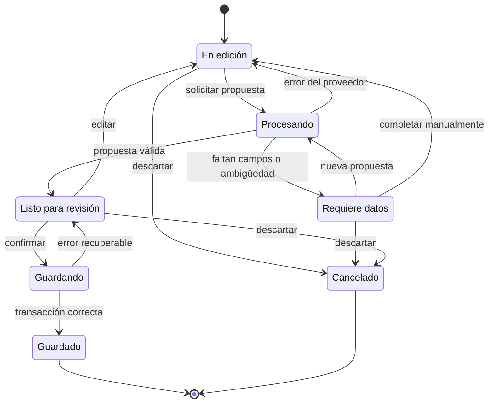

# Diseño de la asistencia de IA

## Propósito y límites

La IA ayuda al técnico a convertir texto sobre una atención solucionada en un registro estructurado. Propone una clasificación y un borrador; el técnico revisa y confirma. No determina por sí sola que una atención quedó resuelta, no guarda tickets durante la conversación y no dispone de acceso administrativo a la base de datos.

El registro manual utiliza el mismo dominio y permanece disponible sin IA. La primera versión no recibe mensajes directamente de WhatsApp: el técnico aporta texto evitando transcripciones o datos personales innecesarios.

## Flujo del chatbot

1. **Entrada:** el técnico autenticado describe el problema atendido y la solución aplicada. La interfaz recuerda que solo se registran atenciones resueltas.
2. **Preparación:** una Edge Function verifica sesión, tamaño, frecuencia y formato. Reduce datos personales enviados al proveedor cuando sea posible y obtiene las categorías permitidas.
3. **Interpretación:** el adaptador solicita una respuesta estructurada con los datos identificados, categoría propuesta, información faltante y dudas.
4. **Validación de propuesta:** el servidor comprueba el contrato, tipos, longitudes y pertenencia de la categoría al catálogo. Una salida inválida no llega como dato confiable al formulario.
5. **Aclaración:** si hay ambigüedad o faltan campos, el sistema solicita información o permite completarla manualmente. Si no consta una solución, no declara resuelta la atención.
6. **Vista previa editable:** el técnico revisa los campos extraídos y la clasificación, completa lo necesario y verifica la solución. Se identifica claramente el contenido como borrador.
7. **Confirmación:** una acción explícita, por ejemplo «Confirmar y registrar atención resuelta», envía la versión revisada a la operación de creación. No basta con que el modelo escriba que el ticket está confirmado.
8. **Guardado:** el servidor revalida sesión, permisos, catálogo y datos; deriva al técnico autenticado. PostgreSQL genera el código y guarda el ticket con su auditoría en una transacción.
9. **Resultado:** solo después de confirmarse la transacción se muestra el código definitivo. Ante un error, se conserva el borrador para corrección o reintento seguro.

## Estados del borrador

| Estado | Significado | Transiciones permitidas |
| --- | --- | --- |
| En edición | Texto o campos que el técnico está preparando. | Solicitar propuesta, completar manualmente o cancelar. |
| Procesando | Petición de interpretación en curso. | Revisar propuesta o volver a edición con error. |
| Requiere datos | Faltan campos o existe ambigüedad. | Aclarar, editar o cancelar. |
| Listo para revisión | Propuesta validada técnicamente y visible para el técnico. | Editar, cancelar o confirmar si cumple las reglas. |
| Guardando | Confirmación explícita en procesamiento. | Guardado o error recuperable. |
| Guardado | Ticket confirmado por PostgreSQL y código disponible. | Consultar el registro. |
| Cancelado | Borrador descartado sin crear ticket. | Iniciar un nuevo borrador. |

Deshabilitar el botón mientras se guarda evita clics accidentales; la protección real contra duplicados debe existir también en servidor. Un cambio posterior a la revisión invalida cualquier autorización de guardado basada en una versión anterior. Las respuestas tardías de IA no deben sobrescribir ediciones nuevas del técnico.

## Contrato conceptual de la propuesta

| Dato | Origen y tratamiento |
| --- | --- |
| Categoría propuesta | Identificador del catálogo autorizado; puede quedar pendiente ante incertidumbre. |
| Nombre de persona | Extraído solo si está explícito o completado por el técnico; no se inventa. Preferir su incorporación local si no es necesario enviarlo al proveedor. |
| Tipo de persona | Estudiante, docente o administrativo; solicitar aclaración si no se distingue. |
| Fecha de atención | Extraída de una referencia inequívoca o completada por el técnico. Las expresiones relativas requieren fecha y zona horaria de referencia y revisión. |
| Ubicación | Opcional, ligada exclusivamente a la atención. |
| Problema y solución | Campos propuestos para describir lo ocurrido; su obligatoriedad final está pendiente. La IA no inventa acciones realizadas. |
| Canal | Campo propuesto para presencial o WhatsApp Business; no implica integración con el servicio. |
| Campos faltantes y dudas | Información auxiliar para revisión; no reemplaza validaciones del servidor. |
| Motivo de clasificación | Explicación breve vinculada al catálogo para facilitar la revisión. |

El código, la identidad del responsable, los permisos y los datos de auditoría no son decisiones del modelo. Los campos desconocidos o no permitidos de la respuesta se rechazan o descartan según un contrato explícito. Una confianza declarada por el modelo no sustituye la confirmación ni constituye una probabilidad calibrada.

## Clasificación y validación

El catálogo de categorías se mantiene fuera del prompt como dato del dominio y se facilita al modelo con identificadores y descripciones. No se crean nuevas categorías a partir del texto generado. Si existen varias opciones plausibles, se muestran para elección o se pide aclaración.

La validación ocurre en tres niveles: la interfaz orienta al técnico; la Edge Function verifica la salida de IA; la operación de creación y las restricciones de PostgreSQL protegen la persistencia. La confirmación vuelve a comprobar categorías desactivadas, sesión vencida y datos alterados desde que se produjo la propuesta.

Como propuesta inicial, los borradores permanecen en memoria de la interfaz, sin persistir conversaciones ni crear tickets parciales. Recargar o cerrar la página puede perderlos; una futura recuperación persistente exige definir conservación y privacidad. El servidor no aceptará operaciones incompletas como tickets de atención resuelta.

## Confirmación e idempotencia

La interfaz enviará una intención explícita de creación asociada al contenido revisado y a un identificador de solicitud. La operación deberá reconocer reintentos de la misma solicitud para devolver el resultado previo sin duplicar el ticket. Debe rechazarse reutilizar ese identificador con un contenido diferente.

La estrategia concreta se definirá en fase 1. Si en fase 3 un agente dispone de herramientas de escritura, el servidor exigirá evidencia de confirmación vinculada al borrador vigente y al usuario, fuera del control del modelo. Una afirmación dentro del texto o una llamada de herramienta por sí sola no autoriza guardar.

## Errores y degradación

| Situación | Detección | Respuesta esperada |
| --- | --- | --- |
| El proveedor no responde a tiempo. | Tiempo de espera agotado en la Edge Function. | Informar y ofrecer reintento acotado o registro manual. |
| La respuesta no cumple el contrato. | Validación de tipos, longitudes y campos permitidos. | Descartar la propuesta; nunca mostrar datos inválidos como confiables. |
| La categoría no pertenece al catálogo vigente. | Comparación con identificadores autorizados. | Mostrar categorías válidas para elegir o pedir aclaración. |
| El texto supera el límite permitido. | Validación de tamaño antes de llamar al proveedor. | Solicitar un resumen o continuar manualmente. |
| Se alcanzó el límite de frecuencia o de consumo. | Control en servidor. | Mensaje temporal y registro manual disponible. |
| La sesión vence al confirmar. | Revalidación de identidad en el guardado. | Pedir reautenticación conservando el borrador. |
| Se reutiliza un identificador de solicitud con otro contenido. | Comparación de idempotencia en servidor. | Rechazar y evitar un ticket inconsistente. |
| Falla la transacción de guardado. | Error de PostgreSQL. | Informar que no se guardó; permitir reintento seguro sin duplicar. |

## Proveedor intercambiable

El contrato del adaptador recibe texto mínimo necesario, catálogo y contexto permitido; devuelve una propuesta estructurada o un error normalizado. Prompts, parámetros y traducciones de formato pertenecen al adaptador, sin modificar la operación de creación.

La elección del proveedor debe considerar calidad en español, salida estructurada, latencia, costos, residencia de datos y condiciones de retención y uso de información. Las credenciales se mantienen en servidor. Configurar tiempos de espera, límites de entrada y reintentos acotados; al fallar, ofrecer edición manual.

## Herramientas y RAG posteriores

Las herramientas se expondrán como operaciones específicas, por ejemplo consultar categorías o buscar atenciones autorizadas, con argumentos tipados, límites de resultados y autorización por llamada. No se expondrá un ejecutor genérico de SQL. El texto del usuario, los tickets y los documentos recuperados son datos no confiables y no pueden ampliar permisos ni cambiar las reglas del sistema.

En fase 4, RAG recuperará contenido aprobado mediante pgvector, aplicará permisos antes de suministrarlo al modelo y presentará fuentes. Si no hay evidencia suficiente, la respuesta debe indicarlo. Las recomendaciones para resolver problemas futuros siguen separadas de la creación de registros de atenciones ya solucionadas.

## Auditoría, privacidad y evaluación

El ticket confirmado genera auditoría con actor, instante y datos relevantes de la operación. Se propone distinguir origen manual o asistido como metadato de trazabilidad. No es necesario conservar todo el diálogo para demostrar quién confirmó el registro.

Los logs técnicos pueden incluir proveedor, versión del adaptador, latencia y resultado, evitando texto personal y secretos. Antes de persistir conversaciones o métricas con contenido debe aprobarse su política de conservación y acceso.

### Minimización y datos personales

- Enviar al proveedor solo el texto necesario para clasificar y estructurar el borrador.
- Evitar nombres, documentos, correos o números de teléfono cuando no sean imprescindibles para la propuesta.
- Preferir que el nombre de la persona y la ubicación se completen en la interfaz si el proveedor no los necesita.
- No incluir credenciales, cadenas de conexión ni datos de otros tickets en el contexto del modelo.
- Tratar el texto del técnico, los tickets y los documentos recuperados como datos no confiables: no pueden modificar instrucciones ni permisos del sistema.
- Registrar motivo, fecha y responsable de cualquier excepción que amplíe los datos enviados.

### Métricas de evaluación

| Métrica | Definición | Umbral |
| --- | --- | --- |
| Exactitud de categoría | Porcentaje de propuestas que coinciden con la categoría validada por el técnico. | Pendiente de acordar. |
| Detección de campos faltantes | Casos incompletos señalados correctamente frente al total de casos incompletos. | Pendiente de acordar. |
| Salida inválida | Porcentaje de respuestas rechazadas por contrato o catálogo. | Debe ser bajo y no bloquear el registro. |
| Latencia | Percentil 95 del tiempo de propuesta percibido por el técnico. | Pendiente de acordar con el proveedor elegido. |
| Costo por borrador | Consumo medio por solicitud, incluido el reintento. | Dentro del presupuesto aprobado. |
| Resistencia a instrucciones maliciosas | Casos de prueba que no alteran permisos, categorías ni reglas. | Todos los casos críticos. |
| Utilidad del borrador | Borradores confirmados con correcciones menores o nulas. | Indicador de mejora, no criterio único de aceptación. |

La evaluación debe cubrir clasificación correcta y ambigua, campos ausentes, nombres repetidos, ausencia de ubicación, fechas relativas, problema no solucionado, salida inválida, caída del proveedor, instrucciones maliciosas, sesión vencida, edición durante una respuesta y doble confirmación. Se verificará también que generar o cancelar borradores no cree filas de tickets. El conjunto de ejemplos y los umbrales se acordarán antes de aceptar la fase 2.

Los límites de consumo, cuotas y presupuesto se definen en [costos y límites](costs-and-limits.md). Las decisiones de proveedor y persistencia de borradores están en [decisiones](decisions.md).
