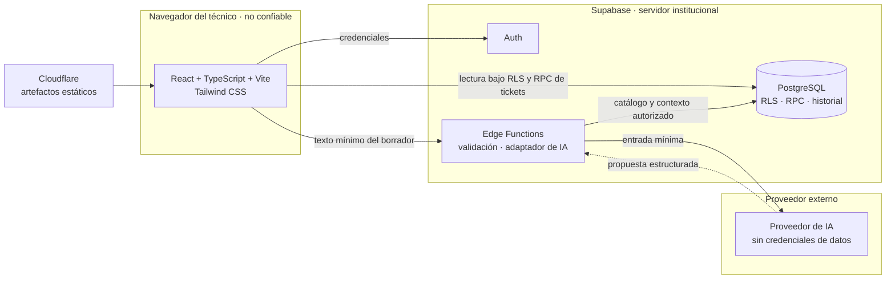
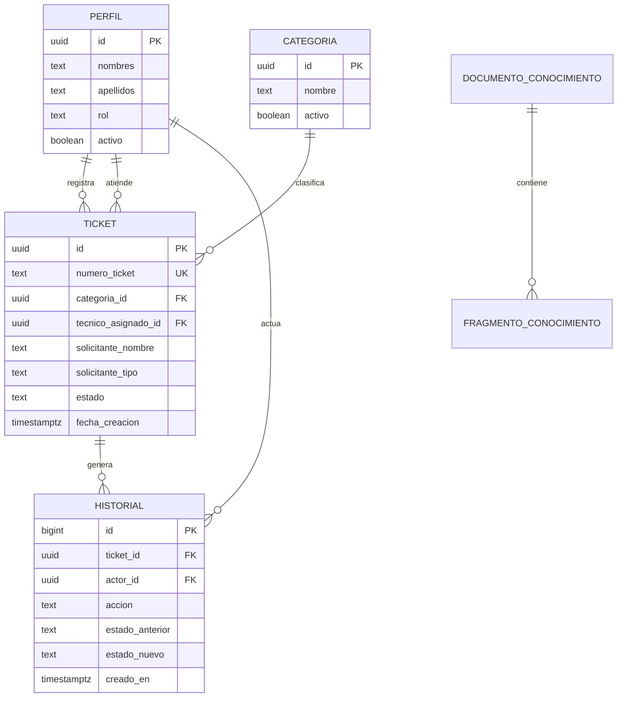
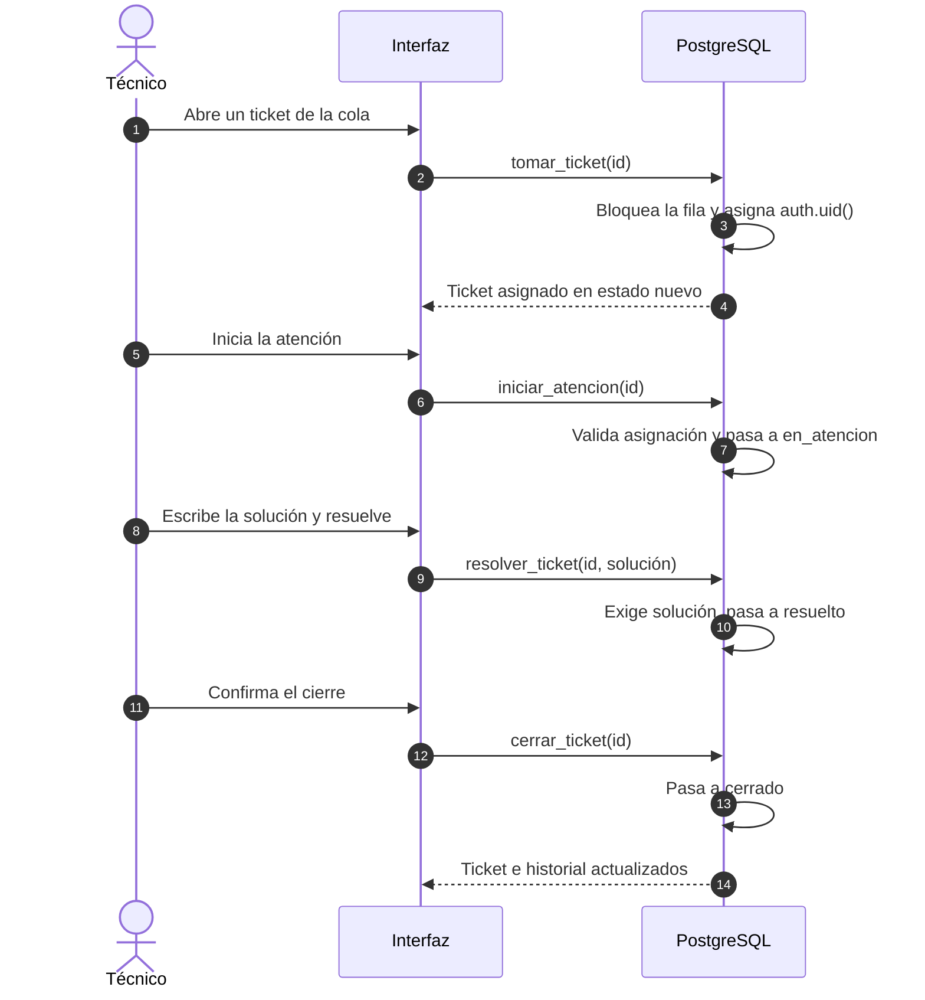
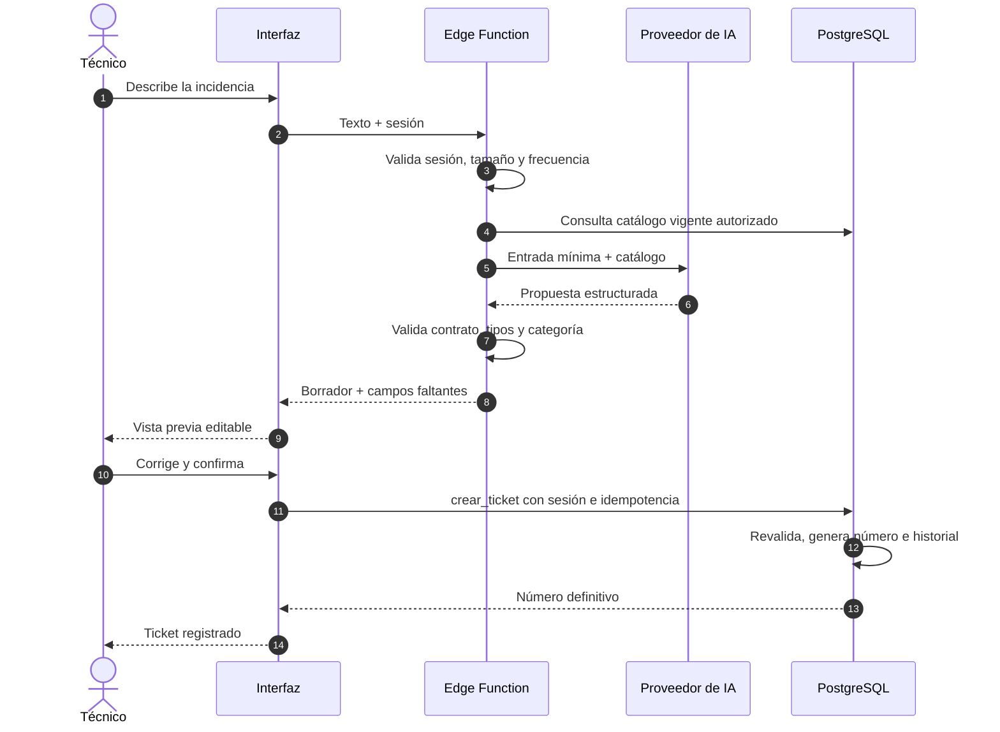

# Arquitectura de TI SmartDesk AI

> **Actualización:** el Área TI usa cuentas individuales `admin` activas y un
> flujo compartido. El navegador solicita transiciones, pero PostgreSQL deriva
> identidad y autorización desde la sesión; `tecnico_asignado_id` solo conserva
> compatibilidad histórica. Los reportes ADMIN se calculan en SQL con zona
> horaria `America/Lima`.

## Estado y alcance

Implementación parcial de la fase 1. Existen la aplicación React con autenticación, los perfiles con RLS y el módulo de tickets con su ciclo de vida, historial y operaciones en PostgreSQL. La IA, el chatbot, RAG, voz, reportes y el despliegue siguen pendientes.

Los técnicos registran incidencias antes de atenderlas, las toman de una cola compartida, inician la atención, registran la solución, cierran el ticket y pueden reabrirlo. No se contempla asignación por especialidad, SLA ni integración directa con WhatsApp en la primera versión.

## Componentes y responsabilidades

| Componente | Responsabilidad | Límites |
| --- | --- | --- |
| Aplicación React, TypeScript y Vite | Bandeja, formulario manual, detalle, historial y acciones del ciclo de vida. | No contiene secretos ni decide permisos por sí sola. |
| Tailwind CSS | Presentación adaptable y estados visuales consistentes. | No sustituye validaciones ni accesibilidad semántica. |
| Supabase Auth | Identidad, inicio y cierre de sesión y emisión de credenciales de sesión. | El alta es manual con un rol de confianza; el responsable institucional está pendiente (DP-05). |
| PostgreSQL | Persistencia, integridad, numeración, transiciones, historial y autorización efectiva. | No acepta identidad del técnico ni estados como datos confiables del navegador. |
| RLS | Autorizar lectura de perfiles, categorías, tickets e historial según identidad. | Las políticas deben cubrir todas las tablas expuestas. |
| Funciones RPC | Concentrar creación y transiciones con validación, bloqueo e historial atómico. | No conceden DML libre ni aceptan actores del cliente. |
| Edge Functions | Validar peticiones, coordinar IA y exponer herramientas seguras. | No ejecutan SQL arbitrario solicitado por el modelo. |
| Adaptador de IA | Traducir solicitudes y respuestas entre el dominio y cada proveedor. | Su contrato usa datos estructurados independientes del proveedor. |
| Proveedor de IA | Interpretar texto y sugerir clasificación o contenido. | No guarda tickets ni recibe credenciales de base de datos. |
| pgvector, fase posterior | Recuperar fragmentos autorizados para RAG. | Requiere evaluación de privacidad, acceso y calidad del corpus. |
| GitHub Actions | Automatizar verificaciones y despliegues cuando exista CI. | Secretos separados por entorno y permisos mínimos. |
| Cloudflare | Publicar la aplicación web compilada. | Auth, datos y funciones permanecen en Supabase. |

## Vista de componentes y límites de confianza



El proveedor de IA no tiene ruta hacia PostgreSQL. Toda escritura nace de una acción del técnico y se ejecuta con controles de servidor.

**Límites de confianza**

- **Navegador:** cualquier dato puede ser manipulado. No se confía en la identidad, el rol, el número, el técnico asignado ni las fechas enviadas por el cliente.
- **Servidor Supabase:** única fuente de autorización. Auth identifica, RLS restringe filas y las RPC validan transiciones, generan el número y escriben el historial.
- **Proveedor de IA:** recibe solo la información necesaria, nunca credenciales. Su salida es datos no confiables hasta pasar la validación del servidor.
- **Cloudflare:** sirve artefactos estáticos. No aloja secretos, lógica de dominio ni datos de tickets.

## Organización lógica

La implementación separa interfaz, contratos del dominio e infraestructura. El registro manual y el futuro registro asistido usarán la misma operación de creación y las mismas reglas de validación. El adaptador de IA evitará acoplar formularios, tickets y categorías al formato de un proveedor.

```text
frontend/src/
  components/     guards de rutas, layout y estados de pantalla
  domain/         tipos, validaciones, permisos y parseo de tickets y perfiles
  features/
    auth/         contexto, proveedor, hook y servicio de autenticación
    tickets/      servicio, errores y componentes del ciclo de vida
  lib/            configuración de entorno y cliente de Supabase
  pages/          login, panel, bandeja, alta, detalle y estados de error
supabase/
  migrations/     perfiles, catálogo, tickets, historial, RLS y RPC
docs/             documentación del proyecto
```

`features/tickets` contiene la consulta y las llamadas RPC, pero no replica reglas de autorización: la decisión final está en PostgreSQL. `domain/ticket.ts` concentra tipos, etiquetas, validaciones de formulario y cálculo de acciones visibles. Las carpetas `features/assistant` y `supabase/functions` se incorporarán en la fase 2. Las integraciones futuras usarán el núcleo privado de creación en servidor y no la sesión del navegador.

## Modelo conceptual de datos

| Entidad | Datos y restricciones principales |
| --- | --- |
| Perfil | Referencia a la identidad de Auth, nombre, rol y condición de acceso. Tres usuarios iniciales, sin especialidades obligatorias. |
| Categoría | Identificador estable, nombre y vigencia. Desactivar una categoría conserva las referencias históricas. |
| Ticket | Identificador interno, número público único, asunto, descripción, categoría, solicitante, ubicación opcional, canal, estado, técnico asignado, solución y fechas del ciclo. |
| Historial | Evento de solo adición con actor, acción, estados anterior y nuevo, detalle y fecha. |
| Documento y fragmento de conocimiento | Entidades futuras para contenido aprobado, procedencia, permisos y representaciones vectoriales. |



Los nombres de las entidades conceptuales se corresponden con las tablas `profiles`, `catalogo_categorias`, `tickets` y `ticket_historial`. `DOCUMENTO_CONOCIMIENTO` y `FRAGMENTO_CONOCIMIENTO` corresponden a la fase 4.

La ubicación pertenece exclusivamente al ticket. No se propone un maestro de docentes con ubicación permanente ni una tabla de personas como requisito inicial. Los nombres pueden repetirse y no constituyen identificadores únicos.

PostgreSQL genera el número mediante una secuencia atómica y una restricción de unicidad. Una secuencia puede tener saltos y no debe prometer numeración continua. El identificador interno y el número público cumplen responsabilidades distintas.

## Flujos de datos

### Registro manual

1. El técnico inicia sesión mediante Auth.
2. Completa el formulario con asunto, descripción, categoría, solicitante, ubicación opcional y canal.
3. La aplicación solicita `crear_ticket` usando su sesión y una clave de idempotencia.
4. PostgreSQL valida permisos, campos y categoría; deriva el creador de la identidad autenticada y genera el número.
5. La misma transacción guarda el ticket en `nuevo` y el evento `creado`. Si falla cualquiera, se revierte la operación.
6. La interfaz muestra el número devuelto y enlaza al detalle.

La creación no asigna técnico ni solución. No requiere invocar al proveedor de IA.

### Ciclo de vida



Si el problema reaparece, `reabrir_ticket` devuelve el ticket a `reabierto`, quita la asignación y limpia las fechas del ciclo. La solución anterior permanece en el historial y la fila conserva el texto para mostrarlo como solución previa.

Todas las transiciones bloquean la fila antes de actuar. Un segundo técnico que intenta tomar el mismo ticket recibe `ticket_ya_tomado`; una transición desde un estado incorrecto recibe `transicion_invalida`.

### Registro asistido

1. La interfaz envía texto a una Edge Function autenticada.
2. El servidor limita tamaño y frecuencia, reduce datos personales y consulta el catálogo permitido.
3. El adaptador solicita una propuesta estructurada al proveedor.
4. El servidor valida la respuesta y devuelve un borrador sin persistir tickets.
5. El técnico corrige el borrador y confirma expresamente.
6. Se ejecuta la misma operación `crear_ticket` del flujo manual, con validación actualizada de sesión y catálogo.



Si la propuesta no supera la validación, el flujo continúa en modo manual sin crear registros parciales.

### Consulta y análisis

La interfaz consulta tickets con la identidad del técnico; RLS permite la lectura compartida al personal activo. Las agregaciones y futuras herramientas de IA deben respetar los mismos límites de acceso. El rol `admin` activo puede supervisar la lectura, pero no ejecutar transiciones.

## Seguridad y auditoría

- Denegar acceso anónimo a información de tickets, categorías, perfiles e historial y aplicar permisos mínimos.
- Resolver el técnico asignado y el actor del historial en el servidor a partir de la sesión verificada. Rechazar intentos de suplantación.
- Mantener las credenciales del proveedor de IA en el servidor. Las claves administrativas de Supabase no se incluyen en el navegador, prompts ni respuestas.
- La escritura de tickets ocurre únicamente mediante RPC acotadas, `security definer`, con `search_path` fijado y sin SQL dinámico. El cliente no recibe DML directo.
- La función privada con actor explícito queda reservada a `service_role` para futuras integraciones; no acepta llamadas del navegador.
- El historial es de solo adición y se escribe en la misma transacción que la transición. Un trigger impide modificarlo o borrarlo.
- No se permite borrado físico de tickets; un trigger lo rechaza.
- No se asume que el historial del proveedor o los logs de infraestructura sustituyen la auditoría del dominio.

## Operación y evolución

Separar desarrollo y producción antes del despliegue. Versionar migraciones, definir copias de seguridad y probar restauración. Incorporar logs con identificadores de correlación y sin transcripciones personales por defecto.

Los errores de IA deben permitir continuar manualmente. Los errores de guardado deben conservar los datos del formulario y evitar duplicados durante reintentos mediante la clave de idempotencia. Las migraciones de tickets deben aplicarse en el orden documentado en [diseño de base de datos](database-design.md).

## Decisiones de arquitectura

| ID | Decisión | Estado | Justificación |
| --- | --- | --- | --- |
| DA-01 | Supabase reúne Auth, PostgreSQL, RLS y Edge Functions. | Aceptada | Reduce operación y mantiene identidad y datos en el mismo perímetro. |
| DA-02 | La creación de tickets se realiza mediante una operación controlada en base de datos, no con inserción directa desde el cliente. | Aceptada | Permite derivar el creador, generar el número y auditar en una sola transacción. |
| DA-03 | El número público se genera con una secuencia atómica de PostgreSQL y restricción de unicidad. | Aceptada | Cumple RN-02 sin coordinación desde la interfaz ni la IA. |
| DA-07 | El historial se escribe en PostgreSQL dentro de la transacción de la operación. | Aceptada | El cliente no puede omitirlo y un fallo revierte el cambio (RN-10). |
| DA-17 | Organización del código por `features` y `domain`. | Aceptada | Permite reutilizar validaciones y probar sin interfaz. |
| DA-19 | Los perfiles operativos viven en `public.profiles`, 1:1 con `auth.users`. | Aceptada | El navegador no puede escribir perfiles ni autoasignarse privilegios. |
| DA-21 | El frontend usa solo la URL y la clave publicable o `anon`. | Aceptada | La autorización depende de RLS, no de secretos embebidos. |
| DA-22 | El ciclo de vida usa cinco estados y separa toma de inicio. | Aceptada | Permite reservar trabajo y conserva trazabilidad de cada paso. |
| DA-23 | Lectura compartida para personal activo; operaciones solo para técnicos activos. | Aceptada | El servicio es un mostrador común; el rol administrativo queda en solo lectura. |
| DA-25 | La idempotencia usa una clave única y una huella del contenido. | Aceptada | Evita duplicados y detecta la reutilización con datos distintos. |
| DA-26 | El número visible usa `TS-` y una secuencia de 6 dígitos. | Aceptada como formato provisional | Cumple RN-02; el formato definitivo se confirma en DP-04. |
| DA-27 | El catálogo inicial de categorías es provisional y de solo lectura para el cliente. | Aceptada como provisional | Permite operar sin bloquear la fase 1; el mantenimiento sigue pendiente. |
| DA-28 | El historial específico de tickets sustituye a una tabla genérica de auditoría. | Aceptada | Cubre las transiciones de fase 1 con menos superficie y reglas claras. |
| DA-29 | La reapertura devuelve el ticket a la cola sin técnico y conserva la solución previa en el historial. | Aceptada | Evita reutilizar una solución obsoleta y mantiene la trazabilidad. |
| DA-30 | Las integraciones externas usarán el núcleo privado de creación con actor explícito. | Aceptada como preparación | Permite incorporar canales sin sesión de técnico sin exponerlo al cliente. |

El registro completo, con contexto, consecuencias y decisiones pendientes, está en [decisiones](decisions.md). El detalle de tablas, políticas RLS e idempotencia está en [diseño de base de datos](database-design.md).

## Decisiones pendientes

- Catálogo definitivo de categorías y responsable de su mantenimiento.
- Corrección de campos ya guardados sin reescribir el historial.
- Formato definitivo del número, zona horaria y posibilidad de fechas retrospectivas.
- Proveedor de IA, residencia y conservación de datos, presupuesto y límites de uso.
- Modalidad de publicación en Cloudflare, dominios, entornos y objetivos de recuperación.
- Responsable institucional del alta, baja y cambios de rol de técnicos.
- Reasignación de tickets cuando el técnico asignado se desactiva o deja de estar disponible (DP-09).

Véanse [reglas de negocio](business-rules.md), [requisitos](requirements.md), [diseño de base de datos](database-design.md), [diseño de IA](ai-design.md), [hoja de ruta](roadmap.md) y [decisiones](decisions.md).
