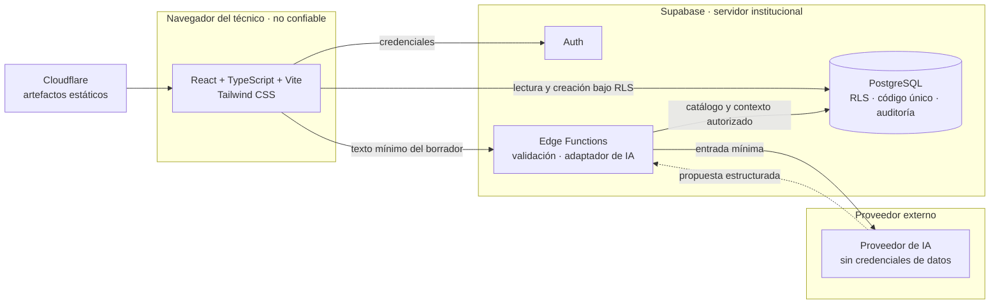
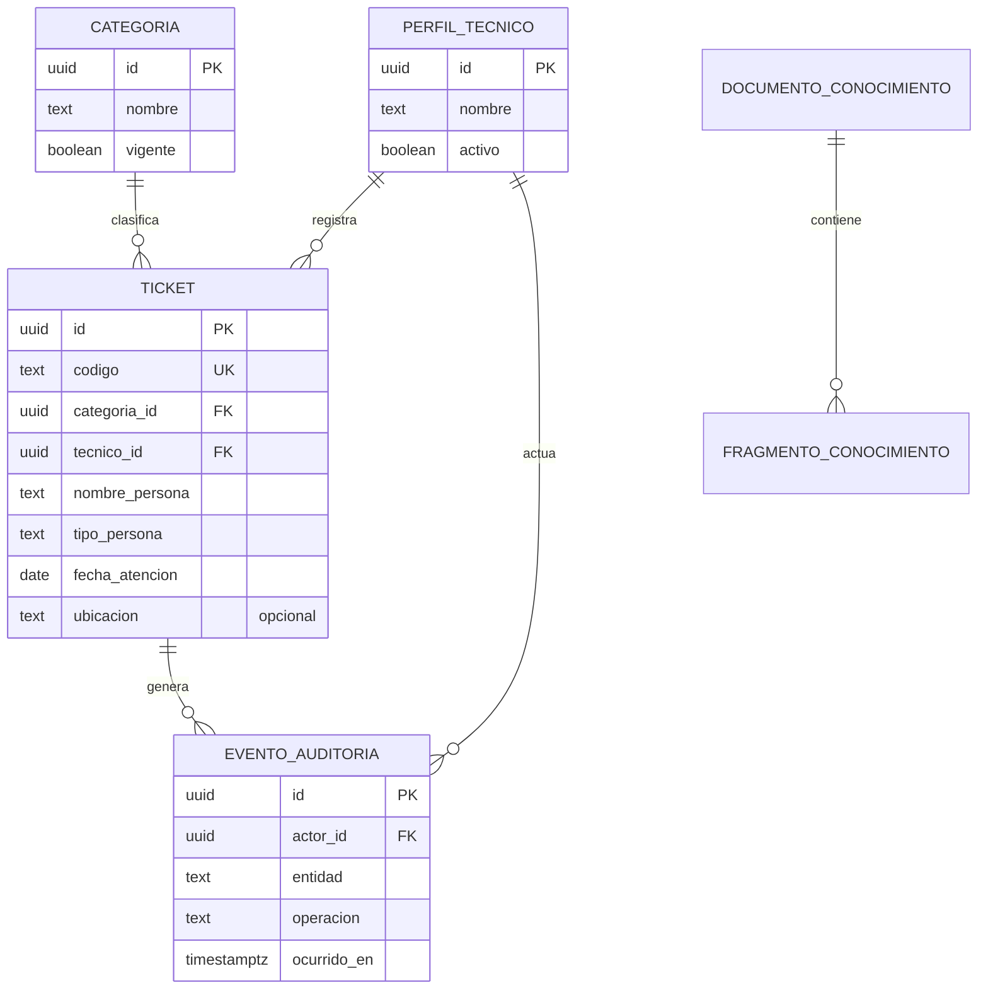
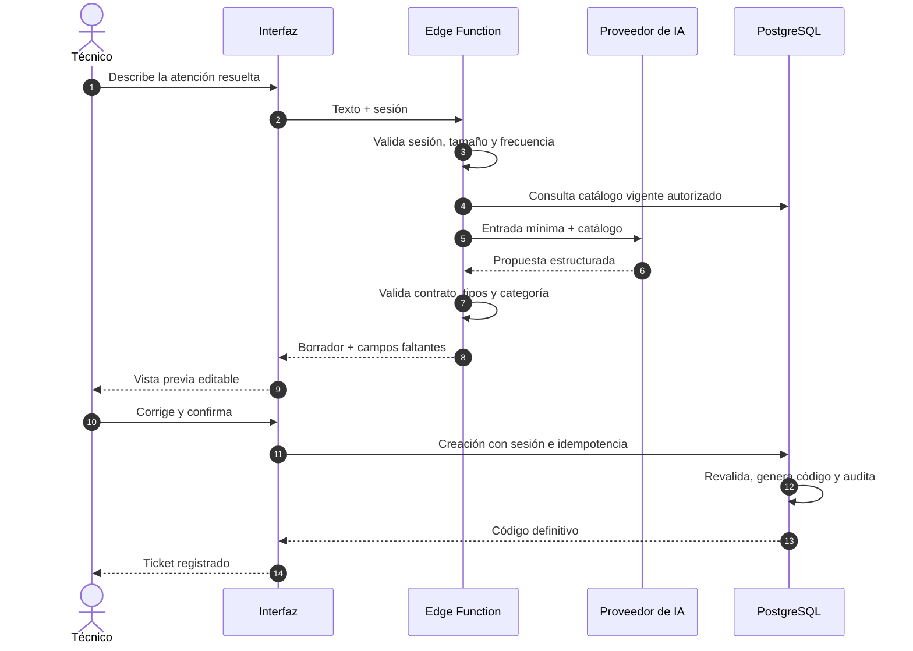

# Arquitectura de TI SmartDesk AI

## Estado y alcance

Diseño propuesto para la fase 0. No existe todavía implementación. El sistema registra atenciones ya solucionadas para una institución educativa y tres técnicos generalistas. No contempla recepción de incidencias abiertas, asignación por especialidad ni integración directa con WhatsApp en la primera versión.

## Componentes y responsabilidades

| Componente | Responsabilidad | Límites |
| --- | --- | --- |
| Aplicación React, TypeScript y Vite | Formularios manuales, consultas, borrador del chatbot y confirmación explícita. | No contiene secretos ni decide permisos por sí sola. |
| Tailwind CSS | Presentación adaptable y estados visuales consistentes. | No sustituye validaciones ni accesibilidad semántica. |
| Supabase Auth | Identidad, inicio y cierre de sesión y emisión de credenciales de sesión. | El mecanismo de alta de técnicos está pendiente. |
| PostgreSQL | Persistencia, integridad, código único, transacciones y auditoría. | No acepta identidad del técnico como dato confiable del navegador. |
| RLS | Autorizar acceso a filas según identidad y política institucional. | Las políticas deben cubrir todas las tablas expuestas. |
| Edge Functions | Validar peticiones, coordinar IA y exponer herramientas seguras. | No ejecutan SQL arbitrario solicitado por el modelo. |
| Adaptador de IA | Traducir solicitudes y respuestas entre el dominio y cada proveedor. | Su contrato usa datos estructurados independientes del proveedor. |
| Proveedor de IA | Interpretar texto y sugerir clasificación o contenido. | No guarda tickets ni recibe credenciales de base de datos. |
| pgvector, fase posterior | Recuperar fragmentos autorizados para RAG. | Requiere evaluación de privacidad, acceso y calidad del corpus. |
| GitHub Actions | Automatizar verificaciones y despliegues cuando exista código. | Secretos separados por entorno y permisos mínimos. |
| Cloudflare | Publicar la aplicación web compilada. | Auth, datos y funciones permanecen en Supabase. |

## Vista de componentes y límites de confianza



El proveedor de IA no tiene ruta hacia PostgreSQL. Toda escritura nace de una acción del técnico y se ejecuta con controles de servidor.

**Límites de confianza**

- **Navegador:** cualquier dato puede ser manipulado. No se confía en la identidad, el rol, el código, el responsable ni las fechas enviadas por el cliente.
- **Servidor Supabase:** única fuente de autorización. Auth identifica, RLS restringe filas y la operación de creación valida y genera el código.
- **Proveedor de IA:** recibe solo la información necesaria, nunca credenciales. Su salida es datos no confiables hasta pasar la validación del servidor.
- **Cloudflare:** sirve artefactos estáticos. No aloja secretos, lógica de dominio ni datos de atenciones.

## Organización lógica

Se propone separar interfaz, casos de uso, contratos del dominio e infraestructura cuando comience la implementación. El registro manual y el asistido utilizarán la misma operación de creación y las mismas reglas de validación. El adaptador de IA evitará acoplar formularios, tickets y categorías al formato de un proveedor.

No se crean todavía carpetas de código ni se fija un framework adicional. La siguiente estructura es una propuesta para la fase 1, sujeta a revisión y coherente con el repositorio actual:

```text
src/
  app/            arranque, rutas y composición de dependencias
  features/
    auth/         inicio y cierre de sesión
    tickets/      registro manual, consulta y filtros
    assistant/    chat, borrador y confirmación
  domain/         tipos, validaciones y reglas independientes de la interfaz
  lib/            cliente de Supabase y utilidades compartidas
  components/     componentes de interfaz reutilizables
supabase/
  migrations/     esquema, RLS, funciones y auditoría versionados
  functions/      Edge Functions de IA y validación
docs/             documentación del proyecto
```

Los límites entre `features` y `domain` permiten reutilizar validaciones en el navegador y en servidor sin duplicar reglas. La estructura definitiva se aprobará al iniciar la fase 1.

## Modelo conceptual de datos

| Entidad | Datos y restricciones principales |
| --- | --- |
| Perfil de técnico | Referencia a la identidad de Auth, nombre y condición de acceso. Tres usuarios iniciales, sin especialidades obligatorias. |
| Categoría | Identificador estable, nombre y vigencia. Desactivar una categoría debe conservar las referencias históricas. |
| Ticket de atención resuelta | Identificador interno, código público único, categoría, nombre y tipo de persona atendida, técnico responsable y fecha de atención. Ubicación opcional. |
| Evento de auditoría | Actor autenticado, operación, entidad, identificador, instante y cambios relevantes, con acceso restringido. |
| Documento y fragmento de conocimiento | Entidades futuras para contenido aprobado, procedencia, permisos y representaciones vectoriales. |



Los nombres son conceptuales y podrán ajustarse en las migraciones; no constituyen un esquema aprobado. `DOCUMENTO_CONOCIMIENTO` y `FRAGMENTO_CONOCIMIENTO` corresponden a la fase 4.

Se propone registrar también descripción del problema, solución aplicada, canal y fecha de creación. Su obligatoriedad debe aprobarse antes del esquema. La fecha de atención expresa cuándo ocurrió el servicio; la fecha de creación es un dato técnico asignado por el servidor. La zona horaria institucional está pendiente de confirmación.

La ubicación pertenece exclusivamente a la atención. No se propone un maestro de docentes con ubicación permanente ni una tabla de personas como requisito inicial. Los nombres pueden repetirse y no constituyen identificadores únicos.

PostgreSQL generará el código mediante un mecanismo atómico, con restricción de unicidad. Su formato visible queda pendiente; una secuencia puede tener saltos y no debe prometer numeración continua. El identificador interno y el código público cumplen responsabilidades distintas.

## Flujos de datos

### Registro manual

1. El técnico inicia sesión mediante Auth.
2. Completa el formulario de atención resuelta y revisa sus datos.
3. La aplicación solicita la creación usando su sesión.
4. La operación de base de datos valida permisos, campos y referencias; obtiene al responsable de la identidad autenticada y genera el código.
5. La misma transacción guarda ticket y auditoría. Si falla cualquiera, se revierte la operación.
6. La interfaz muestra el código devuelto por PostgreSQL y el resultado de la operación.

La implementación podrá usar una operación de base de datos controlada para creación; su contrato debe impedir que el cliente suplante al responsable. No requiere invocar al proveedor de IA.

### Registro asistido

1. La interfaz envía texto a una Edge Function autenticada.
2. El servidor limita tamaño y frecuencia, reduce datos personales y consulta el catálogo permitido.
3. El adaptador solicita una propuesta estructurada al proveedor.
4. El servidor valida la respuesta y devuelve un borrador sin persistir tickets.
5. El técnico corrige el borrador y confirma expresamente.
6. Se ejecuta la misma operación de creación del flujo manual, con validación actualizada de sesión y catálogo.



Si la propuesta no supera la validación, el flujo continúa en modo manual sin crear registros parciales.

### Consulta y análisis

La interfaz consulta tickets con la identidad del técnico; RLS restringe los resultados. Las agregaciones y futuras herramientas de IA deben respetar los mismos límites de acceso. La política de lectura compartida entre los tres técnicos está pendiente; no se presume acceso total.

## Seguridad y auditoría

- Denegar acceso anónimo a información de atenciones y aplicar permisos mínimos.
- Resolver el responsable en el servidor a partir de la sesión verificada. Rechazar intentos de suplantación.
- Mantener las credenciales del proveedor de IA en el servidor. Las claves administrativas de Supabase no se incluyen en el navegador, prompts ni respuestas.
- Preferir operaciones bajo la identidad del usuario y RLS. La creación de tickets es la única excepción privilegiada prevista: una función acotada, revisada y probada, con `search_path` fijado y sin SQL dinámico. Cualquier otra excepción exige alcance limitado y autorización explícita en servidor.
- Implementar auditoría en base de datos para evitar que un cliente pueda omitirla. Como mínimo cubre creación y cambios relevantes en tickets; cambios de categorías y permisos se cubrirán cuando dichas operaciones existan.
- Proteger el registro de auditoría contra edición y eliminación por técnicos; evitar duplicar datos personales o secretos innecesarios.
- No asumir que el historial del proveedor o los logs de infraestructura sustituyen la auditoría del dominio.

## Operación y evolución

Separar desarrollo y producción antes del despliegue. Versionar migraciones cuando existan, definir copias de seguridad y probar restauración. Incorporar logs con identificadores de correlación y sin transcripciones personales por defecto.

Los errores de IA deben permitir continuar manualmente. Los errores de guardado deben conservar el borrador en la interfaz y evitar duplicados durante reintentos; la estrategia de idempotencia se concretará en fase 1.

## Decisiones de arquitectura

| ID | Decisión | Estado | Justificación |
| --- | --- | --- | --- |
| DA-01 | Supabase reúne Auth, PostgreSQL, RLS y Edge Functions. | Aceptada por el stack definido. | Reduce operación para un equipo pequeño y mantiene identidad y datos en el mismo perímetro. |
| DA-02 | La creación de tickets se realiza mediante una operación controlada en base de datos, no con inserción directa desde el cliente. | Propuesta. | Permite derivar el responsable de la sesión, generar el código y auditar en una sola transacción. |
| DA-03 | El código público se genera con un mecanismo atómico de PostgreSQL y restricción de unicidad. | Propuesta. | Cumple RN-02 sin coordinación desde la interfaz ni la IA. |
| DA-04 | La IA se consume mediante un adaptador con contrato estructurado propio. | Aceptada por RNF-04. | Evita acoplar el dominio al formato de un proveedor. |
| DA-05 | Los borradores del chatbot permanecen en memoria de la interfaz durante la fase 2. | Propuesta. | Evita persistir conversaciones sin política de conservación; implica pérdida al recargar. |
| DA-06 | Cloudflare publica solo artefactos estáticos. | Propuesta. | Mantiene la lógica de dominio y los secretos fuera del borde. |
| DA-07 | La auditoría se escribe en PostgreSQL dentro de la transacción de la operación. | Propuesta. | El cliente no puede omitirla y un fallo revierte el cambio (RN-10). |

El registro completo, con contexto, consecuencias y decisiones pendientes, está en [decisiones](decisions.md). El detalle de tablas, políticas RLS e idempotencia está en [diseño de base de datos](database-design.md).

## Decisiones pendientes

- Visibilidad, edición, corrección del responsable y eventual anulación de tickets; no se autoriza borrado físico por defecto.
- Catálogo de categorías, responsables de su mantenimiento y campos obligatorios adicionales.
- Formato de código, precisión de la fecha de atención, zona horaria y posibilidad de registros retrospectivos.
- Proveedor de IA, residencia y conservación de datos, presupuesto y límites de uso.
- Modalidad de publicación en Cloudflare, dominios, entornos y objetivos de recuperación.

Véanse [reglas de negocio](business-rules.md), [requisitos](requirements.md), [diseño de base de datos](database-design.md), [diseño de IA](ai-design.md), [hoja de ruta](roadmap.md) y [decisiones](decisions.md).
