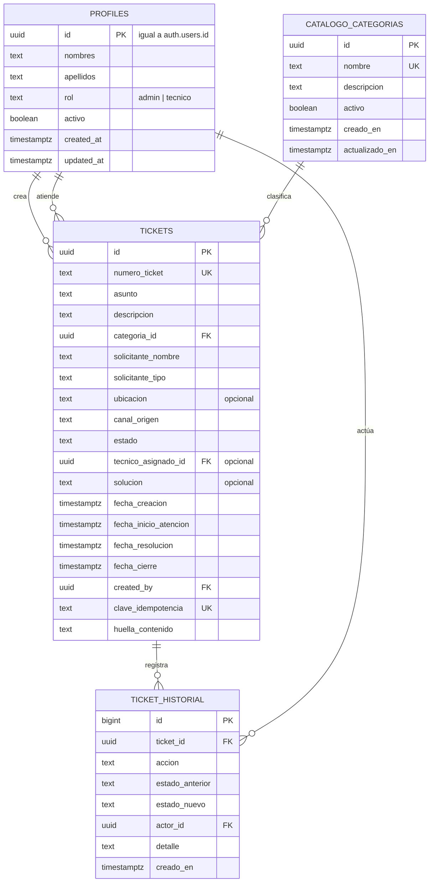
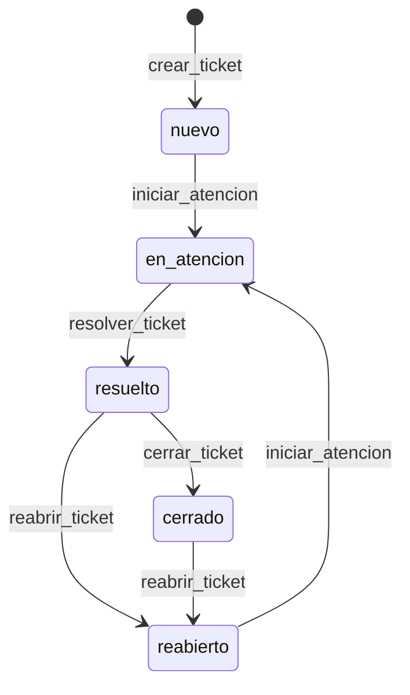

# Diseño de base de datos

## Estado y alcance

La fase 1 implementa en migraciones versionadas `public.profiles`, `public.catalogo_categorias`, `public.tickets`, `public.ticket_historial`, las funciones RPC del ciclo de vida y el reporte de eficiencia para `admin` activo. El diseño cubre la creación de tickets antes de la atención, sus transiciones compartidas, el historial, el reporte y la seguridad por filas. Las entidades de conocimiento y RAG se describen como ampliación futura.

Las migraciones no se aplican automáticamente y todavía no se han ejecutado contra un proyecto Supabase real. Este documento describe el modelo implementado; no sustituye a los archivos SQL.

## Principios

- PostgreSQL es la fuente de verdad de datos, numeración, fechas técnicas e historial.
- El cliente no elige el número, el actor ni los datos del historial.
- Toda tabla expuesta en el esquema público tiene RLS habilitada y políticas explícitas.
- La escritura de tickets tiene una sola vía controlada: funciones RPC; no se concede DML directo al cliente.
- Cada transición y su evento de historial ocurren en la misma transacción.
- No hay borrado físico de tickets ni edición del historial.
- Los estados y las transiciones se restringen en la base, no solo en la interfaz.

## Modelo conceptual

## Tablas

### `profiles`

Se mantiene la tabla existente de la migración `20261026120000_create_profiles.sql`.

| Columna | Tipo | Nulo | Restricción |
| --- | --- | --- | --- |
| `id` | `uuid` | No | PK; referencia a `auth.users(id)` con borrado en cascada; sin alta automática desde el navegador. |
| `nombres` | `text` | No | Longitud de 1 a 100 sin espacios vacíos. |
| `apellidos` | `text` | No | Longitud de 1 a 120 sin espacios vacíos. |
| `rol` | `text` | No | `admin` o `tecnico`; por defecto `tecnico`. |
| `activo` | `boolean` | No | Por defecto `false`; se activa durante el aprovisionamiento. |
| `created_at` / `updated_at` | `timestamptz` | No | Valores del servidor; `updated_at` se actualiza con trigger. |

La migración `20261026130000_create_ticket_foundation.sql` añade:

- `public.is_active_staff()`: `security definer`, `search_path = ''`; devuelve `true` si el usuario autenticado tiene perfil activo con rol `admin` o `tecnico`.
- `public.is_active_technician()`: conserva el nombre histórico, pero desde la operación compartida delega en `is_active_staff()`; no restringe las transiciones a un técnico.
- La política `profiles_select_active_staff`, que permite al personal activo leer todos los perfiles para mostrar nombres de técnicos y actores del historial. Se suma a `profiles_select_own` y `profiles_select_admin`; no se conceden permisos de escritura.

El aprovisionamiento inicial y la baja son operaciones manuales con un rol de confianza, documentadas en [supabase/README.md](../supabase/README.md).

### `catalogo_categorias`

| Columna | Tipo | Nulo | Restricción |
| --- | --- | --- | --- |
| `id` | `uuid` | No | PK con `gen_random_uuid()`. |
| `nombre` | `text` | No | Longitud de 1 a 80; índice único sobre `lower(btrim(nombre))`. |
| `descripcion` | `text` | Sí | Máximo 300 caracteres. |
| `activo` | `boolean` | No | Por defecto `true`. Una categoría inactiva conserva las referencias históricas y no se puede usar en tickets nuevos. |
| `creado_en` / `actualizado_en` | `timestamptz` | No | Valores del servidor; `actualizado_en` se actualiza con trigger. |

La migración inserta un catálogo provisional: Hardware, Software, Redes y conectividad, Cuentas y accesos, Impresoras y Otros. La institución debe revisarlo y mantenerlo mediante una operación administrativa controlada; el cliente solo puede leerlo.

### `tickets`

| Columna | Tipo | Nulo | Restricción |
| --- | --- | --- | --- |
| `id` | `uuid` | No | PK interna con `gen_random_uuid()`. |
| `numero_ticket` | `text` | No | Único; por defecto `TS-` + secuencia con relleno de 6 dígitos. Formato `^TS-[0-9]{6,}$`. |
| `asunto` | `text` | No | Entre 3 y 150 caracteres sin espacios sobrantes. |
| `descripcion` | `text` | No | Entre 5 y 4000 caracteres. |
| `categoria_id` | `uuid` | No | FK a `catalogo_categorias` con `ON DELETE RESTRICT`. |
| `solicitante_nombre` | `text` | No | Entre 2 y 150 caracteres; no es identificador único. |
| `solicitante_tipo` | `text` | No | `estudiante`, `docente` o `administrativo`. |
| `ubicacion` | `text` | Sí | Máximo 200 caracteres. |
| `canal_origen` | `text` | No | `manual`, `ia`, `whatsapp` o `correo`; por defecto `manual`. |
| `estado` | `text` | No | `nuevo`, `en_atencion`, `resuelto`, `cerrado` o `reabierto`; por defecto `nuevo`. |
| `tecnico_asignado_id` | `uuid` | Sí | FK a `profiles` con `ON DELETE RESTRICT`; campo histórico de la antigua toma. No condiciona las transiciones actuales. |
| `solucion` | `text` | Sí | Entre 5 y 4000 caracteres cuando existe. Obligatoria en `resuelto` y `cerrado`. |
| `fecha_creacion` | `timestamptz` | No | Valor del servidor. |
| `fecha_inicio_atencion` | `timestamptz` | Sí | Se registra al iniciar; obligatoria en `en_atencion`. |
| `fecha_resolucion` | `timestamptz` | Sí | Se registra al resolver; obligatoria en `resuelto` y `cerrado`. |
| `fecha_cierre` | `timestamptz` | Sí | Se registra al cerrar; obligatoria en `cerrado`. |
| `created_by` | `uuid` | Sí | FK a `profiles`; en la interfaz se deriva del actor. Queda nulo solo si una integración autorizada no lo informa. |
| `clave_idempotencia` | `text` | Sí | Única; máximo 200 caracteres. |
| `huella_contenido` | `text` | Sí | MD5 hexadecimal de 32 caracteres; la interfaz no la muestra ni la usa. |
| `actualizado_en` | `timestamptz` | No | Valor del servidor; se actualiza con trigger. |

Restricciones de coherencia más relevantes:

- `tickets_en_atencion_completo`: `en_atencion` exige fecha de inicio; no exige técnico asignado.
- `tickets_resuelto_completo` y `tickets_cerrado_completo`: exigen solución y fechas correspondientes; no exigen técnico asignado.
- `tickets_fechas_coherentes`: las fechas del ciclo no pueden ser anteriores a la creación ni invertir su orden.
- La tabla no admite `DELETE` mediante un trigger de protección; no existen políticas de escritura.

El número lo genera PostgreSQL a partir de `public.ticket_numero_seq`. Una secuencia puede tener saltos por transacciones revertidas; el número no promete continuidad.

### `ticket_historial`

| Columna | Tipo | Nulo | Restricción |
| --- | --- | --- | --- |
| `id` | `bigint` | No | PK con identidad; orden de inserción. |
| `ticket_id` | `uuid` | No | FK a `tickets` con `ON DELETE RESTRICT`. |
| `accion` | `text` | No | `creado`, `tomado`, `iniciado`, `resuelto`, `cerrado` o `reabierto`. `tomado` solo aparece en datos históricos. |
| `estado_anterior` | `text` | Sí | Nulo solo en la creación. |
| `estado_nuevo` | `text` | No | Estado resultante de la acción. |
| `actor_id` | `uuid` | No | FK a `profiles`; siempre deriva de la sesión o de la integración autorizada. |
| `detalle` | `text` | Sí | Máximo 4000 caracteres; contiene la solución o el motivo de reapertura. |
| `creado_en` | `timestamptz` | No | Valor del servidor. |

Un trigger rechaza `UPDATE` y `DELETE` incluso para roles de aplicación. La tabla es de solo adición mediante las funciones RPC.

### Ampliación futura: conocimiento

En fase 4 se incorporarán `knowledge_documents` y `knowledge_chunks` con procedencia, permisos, vigencia y representaciones vectoriales. La extensión `pgvector` y sus índices se añadirán entonces, no antes.

## Ciclo de vida y transiciones

| Operación | Estado de origen | Quién | Efecto |
| --- | --- | --- | --- |
| `crear_ticket` | — | Perfil activo `admin` o `tecnico` | Crea en `nuevo`, sin técnico asignado, con número e historial `creado`. |
| `iniciar_atencion` | `nuevo` o `reabierto` | Cualquier perfil activo `admin` o `tecnico` | Pasa a `en_atencion` y registra la fecha de inicio. No exige asignación. |
| `resolver_ticket` | `en_atencion` | Cualquier perfil activo `admin` o `tecnico` | Exige solución; pasa a `resuelto` y registra la fecha. |
| `cerrar_ticket` | `resuelto` | Cualquier perfil activo `admin` o `tecnico` | Pasa a `cerrado` y registra la fecha de cierre. |
| `reabrir_ticket` | `resuelto` o `cerrado` | Cualquier perfil activo `admin` o `tecnico` | Pasa a `reabierto`, limpia fechas del ciclo y conserva la solución anterior y `tecnico_asignado_id` como referencia histórica. |

La toma individual ya no existe. El ticket pertenece al Área TI y cualquier operador activo puede continuar el ciclo sin reservarlo. La fila se bloquea con `FOR UPDATE` antes de cada transición, lo que impide carreras de estado. Las operaciones repetidas por el mismo actor en un estado ya alcanzado devuelven el ticket sin duplicar el historial cuando la repetición es segura.

## Contrato de las funciones

La creación y las transiciones se exponen como RPC `public.*` para el rol `authenticated`. Todas:

1. Exigen sesión y perfil activo; las operaciones de tickets aceptan rol `admin` o `tecnico`.
2. Bloquean la fila antes de decidir una transición.
3. Derivan el actor de `auth.uid()`; no aceptan un identificador de actor del cliente.
4. Validan campos, longitudes, categoría activa y estado de origen.
5. Actualizan el ticket y agregan el historial en la misma transacción.
6. Devuelven la fila actualizada de `public.tickets`.

Se definen como `security definer`, con `search_path = ''` y sin SQL dinámico. La ejecución se revoca para `public` y `anon`, y se concede solo a `authenticated`.

La función `private.registrar_ticket_compartido` concentra la creación con un actor explícito. No depende de `auth.uid()`, exige que el actor tenga perfil activo con rol `admin` o `tecnico`, no es accesible para `authenticated` y queda reservada a `service_role` como preparación para integraciones de servidor autorizadas. La interfaz no la usa. La RPC `obtener_reporte_eficiencia()` exige `admin` activo y devuelve las métricas agregadas con filtros opcionales de fecha, categoría y tipo de solicitante.

Errores normalizados (token en el mensaje, traducidos por la interfaz):

| Token | Situación |
| --- | --- |
| `no_autenticado` | No hay sesión válida. |
| `perfil_inactivo` | El perfil no existe, está inactivo o no tiene el rol requerido. |
| `solo_admin` | El reporte de eficiencia exige un perfil `admin` activo. |
| `datos_invalidos` | Falta un campo, excede longitud o el valor no está permitido. |
| `categoria_inactiva` | La categoría no existe o fue desactivada. |
| `ticket_no_encontrado` | El ticket no existe o no es visible. |
| `transicion_invalida` | El estado no admite la operación solicitada o la fila cambió durante la transición. |
| `solucion_requerida` | La resolución no incluye una solución válida. |
| `duplicate_request_conflict` | Se reutilizó la clave de idempotencia con contenido distinto. |
| `historial_inmutable` | Se intentó modificar o borrar un evento. |
| `ticket_no_eliminable` | Se intentó borrar un ticket. |
| `internal_error` | Fallo interno de consistencia; la interfaz muestra un error genérico. No debería ocurrir en operación normal. |

## Idempotencia y concurrencia

- La interfaz genera una clave una vez por intento de creación y la reutiliza si el envío falla.
- `clave_idempotencia` es única en `tickets`; la creación usa `INSERT ... ON CONFLICT DO NOTHING` y recupera la fila existente.
- `huella_contenido` es un MD5 del contenido normalizado. Si la clave coincide y la huella y el actor también, se devuelve el ticket existente; si difieren, se rechaza con `duplicate_request_conflict`.
- La huella no se usa en la interfaz ni se incluye en las consultas de listado.
- La interfaz deshabilita el botón mientras guarda, pero la garantía real está en la base de datos.
- Las pruebas deben cubrir dos confirmaciones simultáneas y un reintento tras perder la respuesta.
- Las transiciones bloquean la fila; el segundo intento simultáneo sobre la misma transición recibe `transicion_invalida` y debe refrescar el ticket.

## Seguridad por filas (RLS)

| Tabla | Anónimo | Operador activo (`admin` o `tecnico`) | Administrador activo |
| --- | --- | --- | --- |
| `profiles` | Sin acceso. | Lee su perfil y, por `profiles_select_active_staff`, todos los perfiles para atribución. | Lee todos los perfiles y accede al reporte de eficiencia. No escribe desde el cliente. |
| `catalogo_categorias` | Sin acceso. | Lee el catálogo completo. | Lee el catálogo completo. |
| `tickets` | Sin acceso. | Lee todos los tickets del mostrador; no escribe directamente. | Lee todos los tickets; ejecuta las mismas RPC de transición que cualquier operador. |
| `ticket_historial` | Sin acceso. | Lee el historial; no escribe directamente. | Lee el historial; no escribe directamente. |

Reglas adicionales:

- RLS habilitada en las cuatro tablas y políticas explícitas de `SELECT`; no hay políticas de `INSERT`, `UPDATE` ni `DELETE`.
- El acceso anónimo se deniega por completo.
- `public.is_active_staff()` y `public.is_active_technician()` son `security definer`, con `search_path` vacío y ejecución revocada para `public` y `anon`, para evitar recursión en RLS. Desde la operación compartida, `is_active_technician()` delega en `is_active_staff()`.
- `public.is_admin()` exige `rol = 'admin'` y `activo = true`; es la única comprobación que separa el reporte de eficiencia de la operación de tickets.
- El usuario puede leer su propia fila aunque esté inactivo; las tablas de dominio exigen un perfil activo.
- El catálogo público de docentes expone solo `id` y `nombre_completo`; `correo_institucional` se resuelve en servidor y no se devuelve al navegador.
- Las claves `service_role` nunca se usan en el navegador. `service_role` conserva `EXECUTE` sobre la RPC pública de alta web y el núcleo privado de creación, pero solo tiene `SELECT` sobre `tickets` y `ticket_historial`; toda escritura pasa por funciones `security definer`.
- Las correcciones futuras no habilitan `UPDATE` libre: se harán mediante operaciones auditadas con campos permitidos.

## Reporte de eficiencia

La RPC `public.obtener_reporte_eficiencia(p_fecha_desde, p_fecha_hasta, p_categoria_id, p_solicitante_tipo)` devuelve `jsonb` con `resumen` y `evolucion`. Reglas de cálculo:

- Exige `is_admin()`; un operador `tecnico` o un perfil inactivo recibe `solo_admin`.
- Los filtros de fecha se interpretan como días completos en `America/Lima`; la categoría y el tipo de solicitante son opcionales.
- `recibidos` cuenta tickets creados dentro del rango; `resueltos` cuenta tickets con un evento real `resuelto` dentro del rango, sin depender del estado actual.
- `pendientes` son los recibidos cuyo estado actual no es `resuelto` ni `cerrado`.
- `reabiertos` cuenta eventos `reabierto` dentro del rango.
- La tasa usa división decimal (`100.0 * resueltos / recibidos`) y se redondea a dos decimales; con cero recibidos devuelve `null`.
- Los promedios de inicio y resolución se calculan sobre los tickets recibidos en el rango y usan solo el ciclo vigente desde la última reapertura del ticket.
- La evolución agrupa por día, semana y mes con la zona horaria institucional; una misma resolución se cuenta una vez por periodo.

## Historial y auditoría

- `creado` se escribe en la misma transacción que el ticket.
- `iniciado`, `resuelto`, `cerrado` y `reabierto` se escriben con su transición. `tomado` solo permanece en registros históricos anteriores a la operación compartida.
- El evento público inicial puede tener `actor_id` nulo solo con acción `creado`, estado anterior nulo, estado nuevo `nuevo` y el detalle canónico del formulario. La restricción es `NOT VALID` para conservar históricos, pero rechaza cualquier fila nueva que no cumpla la condición.
- El evento incluye actor, acción, estados y detalle acotado; no guarda conversaciones completas.
- Un trigger impide `UPDATE` y `DELETE` sobre el historial.
- El historial es la auditoría de dominio y es independiente de los logs técnicos o del proveedor de IA.
- No se implementa una tabla genérica `audit_events`; el historial específico de tickets cubre la fase 1.

## Índices y rendimiento

| Índice | Uso |
| --- | --- |
| Único en `tickets.numero_ticket` | Búsqueda por número y garantía de unicidad. |
| Único en `tickets.clave_idempotencia` | Idempotencia de creación. |
| Único en `lower(btrim(catalogo_categorias.nombre))` | Evita categorías duplicadas. |
| `(estado, fecha_creacion desc)` | Bandeja filtrada por estado. |
| `(categoria_id, fecha_creacion desc)` | Filtro por categoría. |
| `(tecnico_asignado_id, fecha_creacion desc)` | Consulta histórica por responsable anterior; no condiciona la operación actual. |
| `(fecha_creacion desc)` | Listado general. |
| `(ticket_id, creado_en, id)` | Historial cronológico. |

El volumen esperado es bajo; no se justifican particiones, réplicas ni cachés adicionales en la primera versión.

## Migraciones y entornos

Orden de aplicación:

1. `20261026120000_create_profiles.sql`: tabla `profiles`, trigger, `is_admin()` y RLS.
2. `20261026130000_create_ticket_foundation.sql`: helpers de personal, política de lectura de perfiles y `catalogo_categorias` con datos iniciales.
3. `20261026131000_create_tickets.sql`: `tickets`, `ticket_historial`, triggers, índices, RLS y permisos.
4. `20261026132000_create_ticket_rpc.sql`: funciones de creación y transiciones, esquema `private` e idempotencia.
5. `20261029100000_shared_admin_ticket_operations.sql`: operación compartida `admin`/`tecnico`, retiro de `tomar_ticket`, restricciones sin técnico obligatorio y reporte de eficiencia con filtros.

Reglas operativas:

- Migraciones versionadas en `supabase/migrations`, revisadas en Pull Request.
- No se aplican automáticamente ni desde la aplicación.
- Un entorno local con Supabase CLI para desarrollo y pruebas.
- Producción separada; las migraciones se aplican de forma controlada.
- Cambios destructivos requieren respaldo previo y una migración compensatoria; no se edita una migración ya aplicada.
- Los datos de prueba son sintéticos y no contienen información real de la comunidad educativa.
- El aprovisionamiento de cuentas y perfiles se realiza manualmente; ver [supabase/README.md](../supabase/README.md).
- Las pruebas de integración SQL viven en `supabase/tests` y requieren un proyecto Supabase local o de staging autorizado. No se ejecutan contra producción.

## Trazabilidad de reglas

| Regla | Mecanismo |
| --- | --- |
| RN-01 | La creación fija `estado = 'nuevo'`, sin técnico ni solución. |
| RN-02 | Secuencia, formato en servidor y restricción única. |
| RN-03 | Columnas obligatorias, `CHECK` de tipo y FK de categoría. |
| RN-04 | Las RPC derivan el actor de `auth.uid()`; no existe asignación individual obligatoria. |
| RN-05 | `ubicacion` opcional en `tickets`; no existe perfil de persona. |
| RN-06 | El registro y las transiciones manuales no dependen de IA. |
| RN-07 | El borrador no se escribe en `tickets` hasta confirmar. |
| RN-08 | Solo la operación de creación confirmada inserta filas. |
| RN-09 | La IA no recibe credenciales ni acceso a la base; solo la Edge Function autorizada. |
| RN-10 | `ticket_historial` en la misma transacción y con trigger de inmutabilidad. |
| RN-11 | `canal_origen = 'whatsapp'` es un dato manual; no hay webhooks ni tablas de mensajes. |
| RN-12 | La creación rechaza obligatorios ausentes; el borrador no completa valores sin evidencia. |
| RN-13 | `CHECK` de estado y máquina de transiciones en las RPC. |
| RN-14 | `is_active_staff()` en cada RPC; `is_admin()` en el reporte; RLS de lectura para personal activo. |
| RN-15 | `CHECK` y validación de solución; no exige asignación. |
| RN-16 | Trigger de borrado y trigger de inmutabilidad del historial. |
| RN-17 | `SELECT ... FOR UPDATE` y `transicion_invalida` para el segundo intento simultáneo. |
| RN-18 | Clave única, huella de contenido y `ON CONFLICT`. |
| RN-19 | `reabrir_ticket` limpia fechas y asignación; el evento conserva la solución anterior. |

## Decisiones pendientes

- Catálogo definitivo de categorías y responsable de su mantenimiento.
- Corrección de campos ya guardados sin reescribir el historial.
- Formato definitivo del número, zona horaria institucional y reglas de fechas retrospectivas.
- Retención, respaldo y restauración (RPO/RTO).
- Responsable institucional del alta, baja y cambios de rol de técnicos; el procedimiento técnico está en [supabase/README.md](../supabase/README.md).
- Reasignación de los tickets que quedan asignados a un técnico desactivado (DP-09). La operación compartida ya no bloquea esos tickets: cualquier cuenta activa puede continuar el ciclo (resuelta por DA-31).

Véanse [arquitectura](architecture.md), [reglas de negocio](business-rules.md) y [decisiones](decisions.md).
