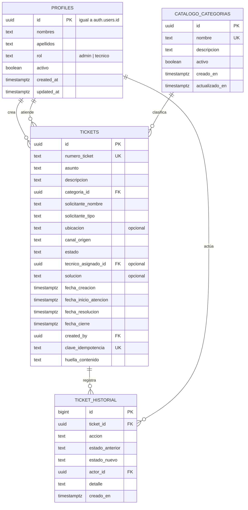
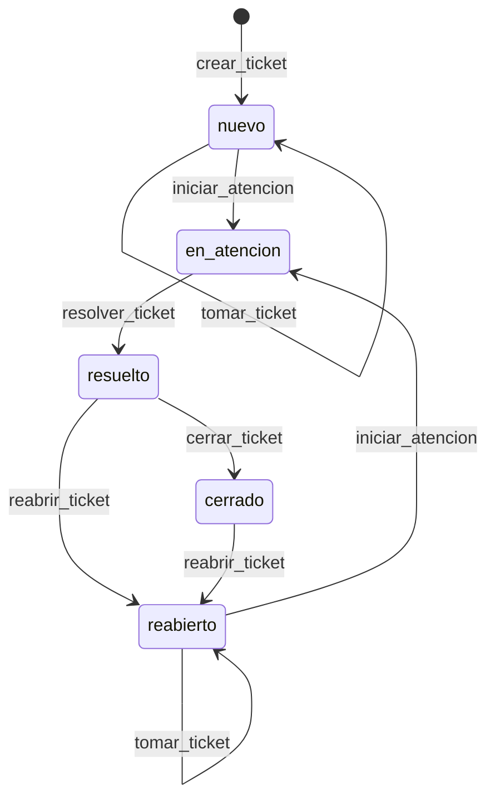

# Diseño de base de datos

## Estado y alcance

La fase 1 implementa en migraciones versionadas `public.profiles`, `public.catalogo_categorias`, `public.tickets`, `public.ticket_historial` y las funciones RPC del ciclo de vida. El diseño cubre la creación de tickets antes de la atención, sus transiciones, el historial y la seguridad por filas. Las entidades de conocimiento y RAG se describen como ampliación futura.

Las migraciones no se aplican automáticamente y todavía no se han ejecutado contra un proyecto Supabase real. Este documento describe el modelo implementado; no sustituye a los archivos SQL.

## Principios

- PostgreSQL es la fuente de verdad de datos, numeración, fechas técnicas e historial.
- El cliente no elige el número, el técnico asignado ni los datos del historial.
- Toda tabla expuesta en el esquema público tiene RLS habilitada y políticas explícitas.
- La escritura de tickets tiene una sola vía controlada: funciones RPC; no se concede DML directo al cliente.
- Cada transición y su evento de historial ocurren en la misma transacción.
- No hay borrado físico de tickets ni edición del historial.
- Los estados y las transiciones se restringen en la base, no solo en la interfaz.

## Modelo conceptual

## Tablas

### `profiles`

Se mantiene la tabla existente de la migración `20261026120000_create_profiles.sql`.

| Columna | Tipo | Nulo | Restricción |
| --- | --- | --- | --- |
| `id` | `uuid` | No | PK; referencia a `auth.users(id)` con borrado en cascada; sin alta automática desde el navegador. |
| `nombres` | `text` | No | Longitud de 1 a 100 sin espacios vacíos. |
| `apellidos` | `text` | No | Longitud de 1 a 120 sin espacios vacíos. |
| `rol` | `text` | No | `admin` o `tecnico`; por defecto `tecnico`. |
| `activo` | `boolean` | No | Por defecto `false`; se activa durante el aprovisionamiento. |
| `created_at` / `updated_at` | `timestamptz` | No | Valores del servidor; `updated_at` se actualiza con trigger. |

La migración `20261026130000_create_ticket_foundation.sql` añade:

- `public.is_active_staff()`: `security definer`, `search_path = ''`; devuelve `true` si el usuario autenticado tiene perfil activo con rol `admin` o `tecnico`.
- `public.is_active_technician()`: misma forma, pero exige `rol = 'tecnico'`.
- La política `profiles_select_active_staff`, que permite al personal activo leer todos los perfiles para mostrar nombres de técnicos y actores del historial. Se suma a `profiles_select_own` y `profiles_select_admin`; no se conceden permisos de escritura.

El aprovisionamiento inicial y la baja son operaciones manuales con un rol de confianza, documentadas en [supabase/README.md](../supabase/README.md).

### `catalogo_categorias`

| Columna | Tipo | Nulo | Restricción |
| --- | --- | --- | --- |
| `id` | `uuid` | No | PK con `gen_random_uuid()`. |
| `nombre` | `text` | No | Longitud de 1 a 80; índice único sobre `lower(btrim(nombre))`. |
| `descripcion` | `text` | Sí | Máximo 300 caracteres. |
| `activo` | `boolean` | No | Por defecto `true`. Una categoría inactiva conserva las referencias históricas y no se puede usar en tickets nuevos. |
| `creado_en` / `actualizado_en` | `timestamptz` | No | Valores del servidor; `actualizado_en` se actualiza con trigger. |

La migración inserta un catálogo provisional: Hardware, Software, Redes y conectividad, Cuentas y accesos, Impresoras y Otros. La institución debe revisarlo y mantenerlo mediante una operación administrativa controlada; el cliente solo puede leerlo.

### `tickets`

| Columna | Tipo | Nulo | Restricción |
| --- | --- | --- | --- |
| `id` | `uuid` | No | PK interna con `gen_random_uuid()`. |
| `numero_ticket` | `text` | No | Único; por defecto `TS-` + secuencia con relleno de 6 dígitos. Formato `^TS-[0-9]{6,}$`. |
| `asunto` | `text` | No | Entre 3 y 150 caracteres sin espacios sobrantes. |
| `descripcion` | `text` | No | Entre 5 y 4000 caracteres. |
| `categoria_id` | `uuid` | No | FK a `catalogo_categorias` con `ON DELETE RESTRICT`. |
| `solicitante_nombre` | `text` | No | Entre 2 y 150 caracteres; no es identificador único. |
| `solicitante_tipo` | `text` | No | `estudiante`, `docente` o `administrativo`. |
| `ubicacion` | `text` | Sí | Máximo 200 caracteres. |
| `canal_origen` | `text` | No | `manual`, `ia`, `whatsapp` o `correo`; por defecto `manual`. |
| `estado` | `text` | No | `nuevo`, `en_atencion`, `resuelto`, `cerrado` o `reabierto`; por defecto `nuevo`. |
| `tecnico_asignado_id` | `uuid` | Sí | FK a `profiles` con `ON DELETE RESTRICT`; nulo mientras no se toma el ticket. |
| `solucion` | `text` | Sí | Entre 5 y 4000 caracteres cuando existe. Obligatoria en `resuelto` y `cerrado`. |
| `fecha_creacion` | `timestamptz` | No | Valor del servidor. |
| `fecha_inicio_atencion` | `timestamptz` | Sí | Se registra al iniciar; obligatoria en `en_atencion`. |
| `fecha_resolucion` | `timestamptz` | Sí | Se registra al resolver; obligatoria en `resuelto` y `cerrado`. |
| `fecha_cierre` | `timestamptz` | Sí | Se registra al cerrar; obligatoria en `cerrado`. |
| `created_by` | `uuid` | Sí | FK a `profiles`; en la interfaz se deriva del actor. Queda nulo solo si una integración autorizada no lo informa. |
| `clave_idempotencia` | `text` | Sí | Única; máximo 200 caracteres. |
| `huella_contenido` | `text` | Sí | MD5 hexadecimal de 32 caracteres; la interfaz no la muestra ni la usa. |
| `actualizado_en` | `timestamptz` | No | Valor del servidor; se actualiza con trigger. |

Restricciones de coherencia más relevantes:

- `tickets_tecnico_requerido`: los estados `en_atencion`, `resuelto` y `cerrado` exigen técnico asignado; `nuevo` y `reabierto` pueden no tenerlo.
- `tickets_en_atencion_completo`: `en_atencion` exige técnico y fecha de inicio.
- `tickets_resuelto_completo` y `tickets_cerrado_completo`: exigen solución y fechas correspondientes.
- `tickets_fechas_coherentes`: las fechas del ciclo no pueden ser anteriores a la creación ni invertir su orden.
- La tabla no admite `DELETE` mediante un trigger de protección; no existen políticas de escritura.

El número lo genera PostgreSQL a partir de `public.ticket_numero_seq`. Una secuencia puede tener saltos por transacciones revertidas; el número no promete continuidad.

### `ticket_historial`

| Columna | Tipo | Nulo | Restricción |
| --- | --- | --- | --- |
| `id` | `bigint` | No | PK con identidad; orden de inserción. |
| `ticket_id` | `uuid` | No | FK a `tickets` con `ON DELETE RESTRICT`. |
| `accion` | `text` | No | `creado`, `tomado`, `iniciado`, `resuelto`, `cerrado` o `reabierto`. |
| `estado_anterior` | `text` | Sí | Nulo solo en la creación. |
| `estado_nuevo` | `text` | No | Estado resultante de la acción. |
| `actor_id` | `uuid` | No | FK a `profiles`; siempre deriva de la sesión o de la integración autorizada. |
| `detalle` | `text` | Sí | Máximo 4000 caracteres; contiene la solución o el motivo de reapertura. |
| `creado_en` | `timestamptz` | No | Valor del servidor. |

Un trigger rechaza `UPDATE` y `DELETE` incluso para roles de aplicación. La tabla es de solo adición mediante las funciones RPC.

### Ampliación futura: conocimiento

En fase 4 se incorporarán `knowledge_documents` y `knowledge_chunks` con procedencia, permisos, vigencia y representaciones vectoriales. La extensión `pgvector` y sus índices se añadirán entonces, no antes.

## Ciclo de vida y transiciones

| Operación | Estado de origen | Quién | Efecto |
| --- | --- | --- | --- |
| `crear_ticket` | — | Técnico activo | Crea en `nuevo`, sin técnico, con número e historial `creado`. |
| `tomar_ticket` | `nuevo` o `reabierto` | Técnico activo | Asigna el técnico; no cambia de estado. Registra `tomado`. |
| `iniciar_atencion` | `nuevo` o `reabierto` | Técnico asignado | Pasa a `en_atencion` y registra la fecha de inicio. |
| `resolver_ticket` | `en_atencion` | Técnico asignado | Exige solución; pasa a `resuelto` y registra la fecha. |
| `cerrar_ticket` | `resuelto` | Técnico asignado | Pasa a `cerrado` y registra la fecha de cierre. |
| `reabrir_ticket` | `resuelto` o `cerrado` | Técnico activo | Pasa a `reabierto`, quita la asignación, limpia fechas del ciclo y conserva la solución anterior como referencia y en el historial. |

La toma y el inicio se separan para reservar trabajo sin iniciar la atención. La fila se bloquea con `FOR UPDATE` antes de cada transición, lo que impide tomas simultáneas y carreras de estado. Las operaciones repetidas por el mismo actor en un estado ya alcanzado devuelven el ticket sin duplicar el historial cuando la repetición es segura.

## Contrato de las funciones

La creación y las transiciones se exponen como RPC `public.*` para el rol `authenticated`. Todas:

1. Exigen sesión y perfil activo; las operaciones de tickets exigen además rol `tecnico`.
2. Bloquean la fila antes de decidir una transición.
3. Derivan el actor de `auth.uid()`; no aceptan un identificador de actor del cliente.
4. Validan campos, longitudes, categoría activa y estado de origen.
5. Actualizan el ticket y agregan el historial en la misma transacción.
6. Devuelven la fila actualizada de `public.tickets`.

Se definen como `security definer`, con `search_path = ''` y sin SQL dinámico. La ejecución se revoca para `public` y `anon`, y se concede solo a `authenticated`.

La función `private.registrar_ticket` concentra la creación con un actor explícito. No depende de `auth.uid()`, exige que el actor tenga perfil activo con rol `tecnico`, no es accesible para `authenticated` y queda reservada a `service_role` como preparación para integraciones de servidor autorizadas. La interfaz no la usa.

Errores normalizados (token en el mensaje, traducidos por la interfaz):

| Token | Situación |
| --- | --- |
| `no_autenticado` | No hay sesión válida. |
| `perfil_inactivo` | El perfil no existe, está inactivo o no tiene el rol requerido. |
| `datos_invalidos` | Falta un campo, excede longitud o el valor no está permitido. |
| `categoria_inactiva` | La categoría no existe o fue desactivada. |
| `ticket_no_encontrado` | El ticket no existe o no es visible. |
| `transicion_invalida` | El estado no admite la operación solicitada. |
| `ticket_ya_tomado` | Otro técnico tomó el ticket antes. |
| `sin_asignacion` | La operación exige que el ticket esté asignado al técnico actual. |
| `solucion_requerida` | La resolución no incluye una solución válida. |
| `duplicate_request_conflict` | Se reutilizó la clave de idempotencia con contenido distinto. |
| `historial_inmutable` | Se intentó modificar o borrar un evento. |
| `ticket_no_eliminable` | Se intentó borrar un ticket. |
| `internal_error` | Fallo interno de consistencia; la interfaz muestra un error genérico. No debería ocurrir en operación normal. |

## Idempotencia y concurrencia

- La interfaz genera una clave una vez por intento de creación y la reutiliza si el envío falla.
- `clave_idempotencia` es única en `tickets`; la creación usa `INSERT ... ON CONFLICT DO NOTHING` y recupera la fila existente.
- `huella_contenido` es un MD5 del contenido normalizado. Si la clave coincide y la huella y el actor también, se devuelve el ticket existente; si difieren, se rechaza con `duplicate_request_conflict`.
- La huella no se usa en la interfaz ni se incluye en las consultas de listado.
- La interfaz deshabilita el botón mientras guarda, pero la garantía real está en la base de datos.
- Las pruebas deben cubrir dos confirmaciones simultáneas y un reintento tras perder la respuesta.
- Las transiciones bloquean la fila; el segundo intento de toma recibe `ticket_ya_tomado`.

## Seguridad por filas (RLS)

| Tabla | Anónimo | Técnico activo | Administrador activo |
| --- | --- | --- | --- |
| `profiles` | Sin acceso. | Lee su perfil y, por `profiles_select_active_staff`, todos los perfiles para atribución. | Lee todos los perfiles. No escribe desde el cliente. |
| `catalogo_categorias` | Sin acceso. | Lee el catálogo completo. | Lee el catálogo completo. |
| `tickets` | Sin acceso. | Lee todos los tickets del mostrador; no escribe directamente. | Lee todos los tickets; no ejecuta transiciones. |
| `ticket_historial` | Sin acceso. | Lee el historial; no escribe directamente. | Lee el historial; no escribe directamente. |

Reglas adicionales:

- RLS habilitada en las cuatro tablas y políticas explícitas de `SELECT`; no hay políticas de `INSERT`, `UPDATE` ni `DELETE`.
- El acceso anónimo se deniega por completo.
- `public.is_active_staff()` y `public.is_active_technician()` son `security definer`, con `search_path` vacío y ejecución revocada para `public` y `anon`, para evitar recursión en RLS.
- El usuario puede leer su propia fila aunque esté inactivo; las tablas de dominio exigen un perfil activo.
- Las claves `service_role` nunca se usan en el navegador. La única función reservada a `service_role` es el núcleo privado de creación para futuras integraciones.
- Las correcciones futuras no habilitan `UPDATE` libre: se harán mediante operaciones auditadas con campos permitidos.

## Historial y auditoría

- `creado` se escribe en la misma transacción que el ticket.
- `tomado`, `iniciado`, `resuelto`, `cerrado` y `reabierto` se escriben con su transición.
- El evento incluye actor, acción, estados y detalle acotado; no guarda conversaciones completas.
- Un trigger impide `UPDATE` y `DELETE` sobre el historial.
- El historial es la auditoría de dominio y es independiente de los logs técnicos o del proveedor de IA.
- No se implementa una tabla genérica `audit_events`; el historial específico de tickets cubre la fase 1.

## Índices y rendimiento

| Índice | Uso |
| --- | --- |
| Único en `tickets.numero_ticket` | Búsqueda por número y garantía de unicidad. |
| Único en `tickets.clave_idempotencia` | Idempotencia de creación. |
| Único en `lower(btrim(catalogo_categorias.nombre))` | Evita categorías duplicadas. |
| `(estado, fecha_creacion desc)` | Bandeja filtrada por estado. |
| `(categoria_id, fecha_creacion desc)` | Filtro por categoría. |
| `(tecnico_asignado_id, fecha_creacion desc)` | Trabajo por técnico. |
| `(fecha_creacion desc)` | Listado general. |
| `(ticket_id, creado_en, id)` | Historial cronológico. |

El volumen esperado es bajo; no se justifican particiones, réplicas ni cachés adicionales en la primera versión.

## Migraciones y entornos

Orden de aplicación:

1. `20261026120000_create_profiles.sql`: tabla `profiles`, trigger, `is_admin()` y RLS.
2. `20261026130000_create_ticket_foundation.sql`: helpers de personal, política de lectura de perfiles y `catalogo_categorias` con datos iniciales.
3. `20261026131000_create_tickets.sql`: `tickets`, `ticket_historial`, triggers, índices, RLS y permisos.
4. `20261026132000_create_ticket_rpc.sql`: funciones de creación y transiciones, esquema `private` e idempotencia.

Reglas operativas:

- Migraciones versionadas en `supabase/migrations`, revisadas en Pull Request.
- No se aplican automáticamente ni desde la aplicación.
- Un entorno local con Supabase CLI para desarrollo y pruebas.
- Producción separada; las migraciones se aplican de forma controlada.
- Cambios destructivos requieren respaldo previo y una migración compensatoria; no se edita una migración ya aplicada.
- Los datos de prueba son sintéticos y no contienen información real de la comunidad educativa.
- El aprovisionamiento de cuentas y perfiles se realiza manualmente; ver [supabase/README.md](../supabase/README.md).

## Trazabilidad de reglas

| Regla | Mecanismo |
| --- | --- |
| RN-01 | La creación fija `estado = 'nuevo'`, sin técnico ni solución. |
| RN-02 | Secuencia, formato en servidor y restricción única. |
| RN-03 | Columnas obligatorias, `CHECK` de tipo y FK de categoría. |
| RN-04 | `tomar_ticket` deriva el técnico de `auth.uid()`. |
| RN-05 | `ubicacion` opcional en `tickets`; no existe perfil de persona. |
| RN-06 | El registro y las transiciones manuales no dependen de IA. |
| RN-07 | El borrador no se escribe en `tickets` hasta confirmar. |
| RN-08 | Solo la operación de creación confirmada inserta filas. |
| RN-09 | La IA no recibe credenciales ni acceso a la base; solo la Edge Function autorizada. |
| RN-10 | `ticket_historial` en la misma transacción y con trigger de inmutabilidad. |
| RN-11 | `canal_origen = 'whatsapp'` es un dato manual; no hay webhooks ni tablas de mensajes. |
| RN-12 | La creación rechaza obligatorios ausentes; el borrador no completa valores sin evidencia. |
| RN-13 | `CHECK` de estado y máquina de transiciones en las RPC. |
| RN-14 | `is_active_technician()` dentro de cada RPC; RLS de lectura para personal activo. |
| RN-15 | `CHECK` y validación de solución; asignación obligatoria para resolver. |
| RN-16 | Trigger de borrado y trigger de inmutabilidad del historial. |
| RN-17 | `SELECT ... FOR UPDATE` y `ticket_ya_tomado`. |
| RN-18 | Clave única, huella de contenido y `ON CONFLICT`. |
| RN-19 | `reabrir_ticket` limpia asignación y fechas; el evento conserva la solución. |

## Decisiones pendientes

- Catálogo definitivo de categorías y responsable de su mantenimiento.
- Corrección de campos ya guardados sin reescribir el historial.
- Formato definitivo del número, zona horaria institucional y reglas de fechas retrospectivas.
- Retención, respaldo y restauración (RPO/RTO).
- Responsable institucional del alta, baja y cambios de rol de técnicos; el procedimiento técnico está en [supabase/README.md](../supabase/README.md).
- Reasignación de los tickets que quedan asignados a un técnico desactivado (DP-09); mientras no se defina, el ticket no puede operarse ni tomarse por otro técnico.

Véanse [arquitectura](architecture.md), [reglas de negocio](business-rules.md) y [decisiones](decisions.md).
