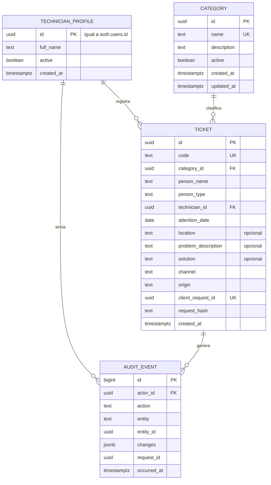

# Diseño de base de datos

## Estado y alcance

Propuesta para la fase 1. Todavía no existen migraciones ni SQL ejecutable en el repositorio. Este documento describe el modelo lógico, las restricciones, la seguridad por filas y los mecanismos de integridad; no sustituye a las migraciones versionadas que se crearán al implementar.

El diseño cubre únicamente el registro de atenciones resueltas, sus catálogos y la auditoría. Las entidades de conocimiento y RAG se describen como ampliación futura.

## Principios

- PostgreSQL es la fuente de verdad de datos, códigos, fechas técnicas y auditoría.
- El cliente no elige el código, el técnico responsable ni los datos de auditoría.
- Toda tabla expuesta en el esquema público tiene RLS habilitada y políticas explícitas.
- La escritura de tickets tiene una sola vía controlada; no se concede DML directo al cliente.
- La creación de un ticket y su evento de auditoría ocurren en la misma transacción.
- No hay borrado físico de tickets ni de auditoría en la primera versión.
- El esquema evita entidades que no aportan valor inmediato, como un maestro de personas o un ciclo de estados de ticket.

## Modelo conceptual

Los nombres son propuestos y pueden ajustarse en las migraciones sin cambiar el significado del dominio.

## Tablas

### `technician_profiles`

| Columna | Tipo | Nulo | Restricción |
| --- | --- | --- | --- |
| `id` | `uuid` | No | PK; referencia a `auth.users(id)`; sin alta automática desde el navegador. |
| `full_name` | `text` | No | Longitud acotada; se muestra en la interfaz y en la auditoría. |
| `active` | `boolean` | No | Por defecto `true`; un técnico inactivo no puede operar. |
| `created_at` | `timestamptz` | No | Valor del servidor. |

El alta y la baja de técnicos requieren una decisión operativa pendiente. No se permite que un usuario se autoasigne el rol.

### `categories`

| Columna | Tipo | Nulo | Restricción |
| --- | --- | --- | --- |
| `id` | `uuid` | No | PK. |
| `name` | `text` | No | Único, sin distinción de mayúsculas ni espacios sobrantes. |
| `description` | `text` | Sí | Texto breve usado para clasificar y para el prompt. |
| `active` | `boolean` | No | Por defecto `true`. Desactivar conserva referencias históricas. |
| `created_at` | `timestamptz` | No | Valor del servidor. |
| `updated_at` | `timestamptz` | No | Se actualiza en cada cambio auditado. |

Se propone una tabla y no un tipo enumerado para permitir mantenimiento sin migración estructural. El catálogo inicial está pendiente de aprobación.

### `tickets`

| Columna | Tipo | Nulo | Restricción |
| --- | --- | --- | --- |
| `id` | `uuid` | No | PK interna; no se usa como código visible. |
| `code` | `text` | No | Único; generado por el servidor; inmutable. |
| `category_id` | `uuid` | No | FK a `categories`; la categoría debe existir y estar activa al crear. |
| `person_name` | `text` | No | Longitud acotada; no es identificador único. |
| `person_type` | `text` | No | `estudiante`, `docente` o `administrativo`. |
| `technician_id` | `uuid` | No | FK a `technician_profiles`; derivado de la sesión. |
| `attention_date` | `date` | No | Fecha del servicio; no puede ser futura salvo decisión expresa. |
| `location` | `text` | Sí | Ubicación de esa atención; nunca se propaga a un perfil de persona. |
| `problem_description` | `text` | Sí | Obligatoriedad pendiente de aprobación. |
| `solution` | `text` | Sí | Obligatoriedad pendiente de aprobación. |
| `channel` | `text` | No | `presencial` o `whatsapp`; este último no implica integración. |
| `origin` | `text` | No | `manual` o `asistido`; metadato de trazabilidad. |
| `client_request_id` | `uuid` | No | Generado por la interfaz; único por técnico para idempotencia. |
| `request_hash` | `text` | No | Huella del contenido enviado; detecta reutilización con datos distintos. |
| `created_at` | `timestamptz` | No | Valor del servidor; distinto de `attention_date`. |

No se incluye columna de estado: por definición, todo registro es una atención resuelta. Una consulta pendiente no genera ticket.

### `audit_events`

| Columna | Tipo | Nulo | Restricción |
| --- | --- | --- | --- |
| `id` | `bigint` | No | PK con identidad; orden de inserción. |
| `actor_id` | `uuid` | No | Usuario autenticado que ejecutó la operación. |
| `action` | `text` | No | Por ejemplo, `ticket.created` o `ticket.updated`. |
| `entity` | `text` | No | Tabla o entidad afectada. |
| `entity_id` | `uuid` | No | Identificador del registro afectado. |
| `changes` | `jsonb` | Sí | Campos relevantes modificados, sin secretos ni texto innecesario. |
| `request_id` | `uuid` | Sí | Correlación con la solicitud de la interfaz. |
| `occurred_at` | `timestamptz` | No | Valor del servidor. |

La tabla es de solo adición. No se conceden permisos de actualización ni de borrado a ningún rol de aplicación. La consulta se restringe a perfiles autorizados según la política pendiente.

### Ampliación futura: conocimiento

En fase 4 se incorporarán `knowledge_documents` (título, contenido aprobado, procedencia, permisos, vigencia) y `knowledge_chunks` (fragmento, referencia al documento, vector). La extensión `pgvector` y sus índices se añadirán entonces, no antes.

## Generación del código

- Una secuencia de PostgreSQL proporciona valores atómicos y admite concurrencia.
- La función de creación compone el código visible a partir de la secuencia y una fecha institucional.
- La restricción de unicidad protege incluso si el formato cambia.
- El código es inmutable y nunca lo propone el navegador ni la IA.
- Una secuencia puede tener saltos por transacciones revertidas; el código no promete numeración continua.
- El formato definitivo, por ejemplo con prefijo y año, está pendiente de aprobación.

## Contrato de creación

La creación se realiza mediante una única función RPC invocada por el cliente autenticado. La función:

1. Verifica que exista una sesión válida y un perfil de técnico activo.
2. Valida campos obligatorios, longitudes, tipo de persona, canal y fecha.
3. Comprueba que la categoría exista y esté activa.
4. Deriva `technician_id` de `auth.uid()`, ignorando cualquier valor enviado por el cliente.
5. Genera `code` y `created_at` en el servidor.
6. Aplica idempotencia mediante `client_request_id` y `request_hash`.
7. Inserta el ticket y el evento `ticket.created` en una sola transacción.
8. Devuelve el ticket creado o un error normalizado.

La función se define como `security definer` con `search_path` fijado y sin SQL dinámico, porque concentra las reglas de escritura y evita conceder DML directo. Al omitir RLS para su ejecución, la autorización depende de sus comprobaciones explícitas de sesión, perfil activo y datos; por eso debe revisarse y probarse en negativo como código sensible. El rol propietario de la función tiene permisos mínimos sobre el esquema y no se expone al cliente. El permiso de ejecución se concede solo al rol autenticado y se revoca para anónimos y públicos. El cliente no recibe permisos de `INSERT`, `UPDATE` ni `DELETE` sobre `tickets`.

Errores esperados, sin exponer detalles internos:

| Código | Situación |
| --- | --- |
| `unauthenticated` | No hay sesión válida. |
| `inactive_technician` | El perfil existe pero está inactivo. |
| `invalid_input` | Falta un campo, excede longitud o el valor no está permitido. |
| `inactive_category` | La categoría no existe o fue desactivada. |
| `duplicate_request_conflict` | Se reutilizó `client_request_id` con contenido distinto. |
| `internal_error` | Fallo no recuperable; no se creó el ticket. |

## Idempotencia y concurrencia

- `client_request_id` se genera una vez por intento de registro y se conserva mientras el borrador exista.
- La combinación `(technician_id, client_request_id)` es única.
- Si llega un reintento con el mismo identificador y el mismo `request_hash`, se devuelve el ticket existente sin crear otro.
- Si el identificador coincide pero el contenido cambió, la operación se rechaza.
- La huella del contenido no se devuelve al cliente ni se expone en consultas de tickets.
- La interfaz deshabilita el botón mientras guarda, pero la garantía real está en la base de datos.
- Las pruebas deben cubrir dos confirmaciones simultáneas y un reintento tras perder la respuesta.

## Seguridad por filas (RLS)

| Tabla | Anónimo | Técnico autenticado | Rol administrativo futuro |
| --- | --- | --- | --- |
| `technician_profiles` | Sin acceso. | Lee su propio perfil y los perfiles activos necesarios para mostrar el responsable. | Gestión completa auditada. |
| `categories` | Sin acceso. | Lee categorías activas y las referencias históricas de tickets autorizados. | Crear, editar y desactivar con auditoría. |
| `tickets` | Sin acceso. | Lee según la política de visibilidad acordada; no escribe directamente. | Sin acceso directo; usa operaciones auditadas. |
| `audit_events` | Sin acceso. | Sin acceso por defecto; solo perfiles autorizados. | Lectura restringida. |

Reglas adicionales:

- RLS habilitada en todas las tablas y políticas explícitas por operación; sin políticas comodín.
- El acceso anónimo se deniega por completo.
- La política de lectura entre técnicos está pendiente. Se propone lectura compartida para las tres cuentas operativas, porque el servicio es un mostrador común; la alternativa es lectura solo de lo propio.
- Las correcciones futuras de tickets no habilitan `UPDATE` libre: se harán mediante operaciones auditadas con campos permitidos.
- Las claves `service_role` nunca se usan en el navegador ni en Edge Functions expuestas al usuario.

## Auditoría

- `ticket.created` se escribe en la misma transacción que el ticket.
- Las futuras actualizaciones o anulaciones generan `ticket.updated` o `ticket.voided` con los campos modificados.
- Los cambios de catálogo y permisos se auditan cuando esas operaciones existan.
- Un trigger de protección impide `UPDATE` y `DELETE` sobre `audit_events`, incluso para roles de aplicación.
- No se guarda el texto completo de la conversación ni datos personales innecesarios en `changes`.
- La auditoría del dominio es independiente de los logs técnicos y no depende del proveedor de IA.

## Índices y rendimiento

| Índice | Uso |
| --- | --- |
| Único en `tickets.code` | Búsqueda por código y garantía de unicidad. |
| Único en `(technician_id, client_request_id)` | Idempotencia. |
| `(attention_date desc, created_at desc)` | Listado cronológico. |
| `(technician_id, attention_date desc)` | Filtro por técnico. |
| `(category_id, attention_date desc)` | Filtro y agregaciones por categoría. |
| `(person_type, attention_date desc)` | Filtro por tipo de persona. |
| Búsqueda de texto en `person_name` | Se evaluará `pg_trgm` solo si la búsqueda parcial lo requiere. |

El volumen esperado es bajo; no se justifican particiones, réplicas ni cachés adicionales en la primera versión.

## Migraciones y entornos

- Migraciones versionadas en `supabase/migrations`, revisadas en Pull Request.
- Un entorno local con Supabase CLI para desarrollo y pruebas.
- Producción separada; las migraciones se aplican de forma controlada y nunca desde la aplicación.
- Cambios destructivos requieren respaldo previo y una migración compensatoria; no se edita una migración ya aplicada.
- Los datos de prueba son sintéticos y no contienen información real de la comunidad educativa.

## Trazabilidad de reglas

| Regla | Mecanismo |
| --- | --- |
| RN-01 | No existe estado de ticket abierto; la interfaz declara atención resuelta. |
| RN-02 | Secuencia, formato en servidor y restricción única. |
| RN-03 | Columnas obligatorias, `CHECK` de tipo y FK de categoría. |
| RN-04 | `technician_id` derivado de `auth.uid()` en la función. |
| RN-05 | `location` opcional en `tickets`; no existe perfil de persona. |
| RN-06 | El registro manual no depende de tablas ni funciones de IA. |
| RN-07 | El borrador no se escribe en `tickets` hasta confirmar. |
| RN-08 | Solo la operación de creación confirmada inserta filas. |
| RN-09 | La IA no recibe credenciales ni acceso a la base; solo la Edge Function autorizada. |
| RN-10 | Evento de auditoría en la misma transacción y tabla inmutable. |
| RN-11 | `channel = whatsapp` es un dato manual; no hay webhooks ni tablas de mensajes. |
| RN-12 | La función de creación rechaza obligatorios ausentes; el borrador no escribe filas y no completa valores sin evidencia. |

## Decisiones pendientes

- Política de visibilidad y corrección entre técnicos.
- Catálogo inicial de categorías y su mantenimiento.
- Formato del código, zona horaria y reglas de fechas retrospectivas.
- Obligatoriedad de descripción, solución y ubicación.
- Retención, respaldo y restauración (RPO/RTO).
- Mecanismo de alta y baja de técnicos.

Véanse [arquitectura](architecture.md), [reglas de negocio](business-rules.md) y [decisiones](decisions.md).
