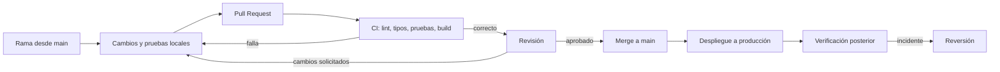

# Flujo de trabajo en GitHub

## Propósito

Definir cómo se proponen, revisan, verifican y publican cambios en TI SmartDesk AI. Aplica a documentación, configuración, migraciones y código de aplicación. Todavía no existen workflows en el repositorio; este documento es el contrato para crearlos en la fase 1.

## Estrategia de ramas

| Rama | Uso | Protección |
| --- | --- | --- |
| `main` | Estado publicable y desplegable. | Protegida; sin push directo; requiere PR y CI en verde. |
| `docs/project-architecture` | Documentación de fase 0. | Temporal; se integra a `main` mediante PR. |
| `feat/<tema>` | Nueva funcionalidad. | Se elimina tras el merge. |
| `fix/<tema>` | Corrección de un defecto. | Se elimina tras el merge. |
| `chore/<tema>` | Mantenimiento, dependencias o configuración. | Se elimina tras el merge. |

Convenciones:

- Nombres cortos, en minúsculas y separados por guiones.
- Una rama contiene un cambio coherente y revisable.
- Rebase o merge desde `main` antes de pedir revisión final, sin reescribir historia ya compartida.
- No se trabaja directamente sobre `main`.

## Flujo de un cambio



## Commits

Formato recomendado, basado en Conventional Commits:

```text
<tipo>(<alcance opcional>): <descripción breve en español>

<cuerpo opcional: qué y por qué>

<referencias opcionales>
```

| Tipo | Uso |
| --- | --- |
| `feat` | Funcionalidad nueva. |
| `fix` | Corrección de comportamiento. |
| `docs` | Solo documentación. |
| `test` | Pruebas. |
| `refactor` | Cambio interno sin alterar comportamiento. |
| `chore` | Configuración, dependencias o mantenimiento. |
| `ci` | Automatización. |

Reglas: mensaje en imperativo, primera línea de hasta 72 caracteres, sin mensajes genéricos como «cambios» o «arreglos».

## Pull Requests

Todo cambio llega por PR. La descripción debe incluir:

- Qué cambia y por qué.
- Requisitos o reglas afectadas (por ejemplo, RF-05, RN-04).
- Cómo se verificó, con pruebas o pasos manuales.
- Riesgos, migraciones o cambios de configuración.
- Capturas solo si aportan y sin datos personales reales.

Criterios para aprobar:

- CI en verde.
- Al menos una revisión de otra persona cuando haya código, migraciones o configuración.
- Los cambios de documentación pueden integrarse con revisión de una persona del equipo.
- Sin secretos, datos personales reales ni artefactos generados.
- Si cambia una regla de negocio, se actualizan requisitos, reglas y pruebas en el mismo PR.

No se autoaprueba un PR que modifique seguridad, RLS o auditoría.

## Integración continua

Etapas previstas, en este orden:

| Etapa | Verificación | Bloquea el merge |
| --- | --- | --- |
| Instalación | Dependencias reproducibles desde el lockfile. | Sí |
| Formato y lint | Reglas del proyecto sin errores. | Sí |
| Tipos | TypeScript en modo estricto. | Sí |
| Pruebas unitarias | Dominio, validaciones e idempotencia. | Sí |
| Pruebas de integración | RLS, funciones y auditoría contra Supabase local. | Sí |
| Build | Compilación de producción. | Sí |
| Pruebas end-to-end | Flujos críticos en un entorno efímero. | Sí para `main` |

Recomendaciones:

- Fijar versiones de acciones y dependencias; evitar `latest`.
- Permisos mínimos del token de GitHub en cada workflow.
- Cachear dependencias solo si reduce tiempo de forma medible.
- No ejecutar workflows con secretos en PR provenientes de forks.
- Publicar el resultado del build como artefacto con identificador de versión.

## Entornos y secretos

| Entorno | Datos | Uso |
| --- | --- | --- |
| Local | Supabase local y datos sintéticos. | Desarrollo y pruebas. |
| Producción | Proyecto Supabase y sitio Cloudflare reales. | Uso institucional. |

Reglas de secretos:

- Las claves `service_role` y las claves de IA viven solo en GitHub Secrets o en el servidor; nunca en el repositorio, el navegador ni los logs.
- El frontend solo recibe la URL del proyecto y la clave anónima, que no otorgan acceso sin RLS.
- Separar secretos por entorno y rotarlos si se exponen.
- Activar el escaneo de secretos y alertas de dependencias de GitHub.
- No imprimir variables de entorno completas en la CI.

## Migraciones de base de datos

1. La migración se crea y prueba en local.
2. Se revisa en el PR junto con las pruebas de RLS.
3. Antes de aplicar en producción se verifica el respaldo y el impacto.
4. La aplicación de migraciones es un paso controlado, no automático desde la aplicación.
5. Una migración aplicada no se edita: se corrige con otra migración.
6. Los cambios destructivos requieren ventana acordada y plan de reversión.

## Despliegue

- Cloudflare publica el resultado estático del build de `main`.
- Supabase aloja Auth, base de datos y Edge Functions.
- Un despliegue se identifica con el commit y la versión del build.
- Las variables de entorno de producción se configuran en el proveedor, no en el código.
- Después de publicar se verifica inicio de sesión, registro manual y consulta.

## Reversión

| Situación | Acción |
| --- | --- |
| Error en el frontend | Revertir el commit o restaurar el despliegue anterior en Cloudflare. |
| Error en una Edge Function | Volver a la versión anterior y revisar logs. |
| Migración defectuosa | Migración compensatoria; restaurar respaldo solo si no hay alternativa segura. |
| Incidente de seguridad | Revocar credenciales, deshabilitar la función afectada y documentar el incidente. |

La reversión de código no revierte datos. Toda operación sobre datos sigue el procedimiento de respaldo y restauración.

## Protección de `main`

- Requiere PR y al menos una aprobación.
- Requiere CI en verde.
- Prohíbe force push y borrado de la rama.
- Requiere rama actualizada antes del merge.
- Restringe quién puede aprobar cambios de seguridad y migraciones.

## Riesgos del flujo

- CI lenta o inestable que incentiva merges sin verificación.
- Secretos filtrados en logs o artefactos.
- Migraciones aplicadas sin respaldo.
- Deriva entre el esquema local y producción.
- Dependencia de una sola persona para aprobar.

Véanse [estrategia de pruebas](testing-strategy.md) y [decisiones](decisions.md).
