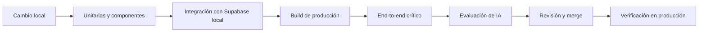

# Estrategia de pruebas

## Objetivos

Verificar que el sistema cumple las reglas de negocio y los requisitos, con prioridad en integridad de datos, autorización, auditoría e idempotencia. El objetivo no es alcanzar un porcentaje de cobertura, sino cubrir los caminos críticos y los fallos con impacto real.

Principios:

- Probar comportamiento observable, no detalles de implementación.
- Probar primero los límites de confianza: sesión, RLS, servidor y base de datos.
- Usar datos sintéticos; nunca información real de estudiantes, docentes o administrativos.
- Las pruebas de IA evalúan calidad y seguridad, no determinismo exacto.
- Un fallo de accesibilidad o de autorización bloquea la entrega.

## Niveles de prueba

| Nivel | Alcance | Herramienta propuesta |
| --- | --- | --- |
| Unitaria | Validaciones de dominio, normalización, cálculo de formularios, manejo de errores. | Vitest. |
| Componentes | Formulario manual, vista previa del borrador, estados de error y confirmación. | Vitest + React Testing Library. |
| Integración de base de datos | Restricciones, función de creación, idempotencia, RLS y auditoría. | Supabase local + pruebas de integración. |
| End-to-end | Flujo manual y flujo asistido completos en navegador. | Playwright. |
| Evaluación de IA | Clasificación, extracción, salida inválida e instrucciones maliciosas. | Conjunto de casos versionado y ejecución por lote. |
| No funcional | Accesibilidad, rendimiento percibido y despliegue. | axe-core, medición manual y CI. |

Las herramientas son propuestas; no se han instalado dependencias.

## Puertas de calidad

Las pruebas unitarias, de componentes, de integración y el build se ejecutan en cada PR. Las end-to-end se ejecutan en PR que toquen flujos críticos y antes de publicar. La evaluación de IA se ejecuta cuando cambie el adaptador, el prompt, el catálogo o el modelo.

## Matriz de cobertura por riesgo

| Área | Casos mínimos | Requisito |
| --- | --- | --- |
| Autenticación | Sesión válida, vencida, ausente y cierre de sesión. | RF-01, RNF-01 |
| Registro manual | Alta completa, campos faltantes, ubicación omitida, categoría inactiva. | RF-02, RF-03, RF-06 |
| Responsable | Intento de enviar otro `technician_id`; se ignora o se rechaza. | RF-04, RN-04 |
| Código | Unicidad en altas concurrentes; código inmutable. | RF-05, RN-02 |
| Consulta | Filtros por código, fecha, categoría, tipo y técnico dentro de permisos. | RF-07 |
| Chatbot | Propuesta válida, ambigüedad, campos ausentes, salida inválida. | RF-08, RF-09 |
| Confirmación | Conversar, editar y cancelar no crean tickets. | RF-10, RN-08 |
| Revalidación | Sesión vencida o categoría desactivada al confirmar. | RF-11 |
| Auditoría | Evento creado con actor, entidad y campos; no editable. | RF-12, RN-10 |
| IA sin acceso | El modelo no recibe credenciales ni ejecuta SQL. | RF-14, RN-09 |
| Idempotencia | Doble clic, reintento tras timeout, mismo ID con otro contenido. | RNF-11 |
| Degradación | IA caída o lenta; el registro manual sigue operativo. | RNF-05 |
| Accesibilidad | Teclado, etiquetas, foco, contraste y mensajes de error. | RNF-06 |
| Privacidad | Logs y auditoría sin texto personal innecesario ni secretos. | RNF-03, RNF-07 |

## Pruebas de autorización y RLS

Cada política se prueba en positivo y en negativo. Matriz mínima:

| Actor | Caso | Resultado esperado |
| --- | --- | --- |
| Anónimo | Leer tickets, categorías, perfiles o auditoría. | Denegado. |
| Anónimo | Invocar la función de creación. | Denegado. |
| Técnico A | Crear un ticket válido. | Permitido; responsable = A. |
| Técnico A | Crear indicando a B como responsable. | El valor se ignora o se rechaza; nunca se guarda B. |
| Técnico A | Leer tickets según la política acordada. | Permitido solo dentro de la política. |
| Técnico A | Actualizar o borrar tickets directamente. | Denegado en la primera versión. |
| Técnico A | Leer o modificar auditoría. | Denegado salvo perfil autorizado. |
| Técnico inactivo | Cualquier operación. | Denegado. |
| Rol administrativo futuro | Operaciones de catálogo. | Permitido y auditado. |

La política de lectura entre técnicos está pendiente (DP-02). Las pruebas deben parametrizarse para no quedar acopladas a una decisión no tomada.

## Idempotencia y concurrencia

- Dos confirmaciones simultáneas con el mismo `client_request_id`: una crea, la otra devuelve el mismo ticket.
- Reintento después de perder la respuesta: no duplica.
- Mismo `client_request_id` con contenido distinto: error `duplicate_request_conflict`.
- Fallo simulado en la auditoría: no queda ticket creado.
- Alta concurrente de varios tickets: códigos distintos y sin colisiones.

## Evaluación de IA

El conjunto de evaluación se versiona y contiene casos sintéticos representativos:

- Clasificación clara, ambigua y fuera del catálogo.
- Texto incompleto o sin solución declarada.
- Fechas relativas y nombres repetidos.
- Ausencia de ubicación y de canal.
- Intento de instrucción maliciosa dentro del texto.
- Respuesta del proveedor fuera de contrato, vacía o truncada.
- Texto en español con errores de escritura y abreviaturas.

Métricas y umbrales se detallan en [diseño de IA](ai-design.md#métricas-de-evaluación). Los umbrales se acuerdan antes de aceptar la fase 2 y no se inventan resultados.

Reglas de la evaluación:

- No se envían datos reales al proveedor durante las pruebas.
- Cada ejecución registra modelo, versión del adaptador, fecha y resultado agregado.
- Un cambio de modelo o de prompt exige volver a ejecutar el conjunto.
- Un caso crítico de fuga de permisos o de datos invalida la versión.

## Seguridad

Casos obligatorios:

- Inyección de instrucciones en el texto del técnico y en documentos recuperados.
- Intento de usar la IA para leer tickets no autorizados.
- Intento de ejecutar SQL o herramientas no expuestas.
- Manipulación de parámetros de la función de creación.
- Acceso con sesión vencida o token inválido.
- Exposición de secretos en el bundle, logs o mensajes de error.
- Reutilización de un identificador de solicitud ajeno.

## Accesibilidad y rendimiento

- Navegación completa con teclado y orden de foco lógico.
- Etiquetas asociadas, mensajes de error legibles y estados no dependientes solo del color.
- Objetivo propuesto: WCAG 2.2 AA.
- Medir tiempo de carga inicial, registro manual y espera de la propuesta de IA.
- Los umbrales numéricos se fijan antes de producción con el equipo y el hardware real.

## Datos y entornos de prueba

- Semillas con categorías y tickets sintéticos reproducibles.
- Reinicio de la base local antes de las pruebas de integración.
- Prohibido copiar datos de producción a entornos de prueba sin anonimizar.
- Los archivos de prueba no incluyen nombres, documentos ni contactos reales.
- Las pruebas de IA usan textos ficticios.

## Aceptación manual

Antes de la fase 6, los tres técnicos realizan:

1. Inicio de sesión y cierre.
2. Registro manual sin IA, incluyendo ubicación omitida.
3. Consulta y filtros por los criterios acordados.
4. Borrador asistido, corrección y confirmación.
5. Verificación de que cancelar no crea tickets.
6. Reintento tras un error de red.
7. Revisión de accesibilidad básica con teclado.

## Pendientes

- Herramientas definitivas y configuración de CI.
- Umbrales de rendimiento y de calidad de IA.
- Política de lectura entre técnicos.
- Estrategia de datos de prueba cuando exista un entorno de staging.

Véanse [flujo de trabajo](github-workflow.md) y [requisitos](requirements.md).
