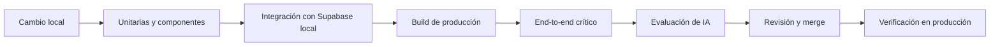

# Estrategia de pruebas

## Objetivos

Verificar que el sistema cumple las reglas de negocio y los requisitos, con prioridad en integridad de datos, autorización, ciclo de vida, historial e idempotencia. El objetivo no es alcanzar un porcentaje de cobertura, sino cubrir los caminos críticos y los fallos con impacto real.

Principios:

- Probar comportamiento observable, no detalles de implementación.
- Probar primero los límites de confianza: sesión, RLS, servidor y base de datos.
- Usar datos sintéticos; nunca información real de estudiantes, docentes o administrativos.
- Las pruebas de IA evalúan calidad y seguridad, no determinismo exacto.
- Un fallo de accesibilidad o de autorización bloquea la entrega.

## Niveles de prueba

| Nivel | Alcance | Herramienta propuesta |
| --- | --- | --- |
| Unitaria | Validaciones de dominio, parseo de filas, permisos calculados, normalización y manejo de errores. | Vitest. |
| Componentes | Bandeja, formulario manual, detalle, historial, acciones y estados de error. | Vitest + React Testing Library. |
| Integración de base de datos | Restricciones, RPC de creación y transiciones, idempotencia, RLS e historial. | Supabase local + pruebas de integración. |
| End-to-end | Flujo manual completo: alta, toma, inicio, resolución, cierre y reapertura. | Playwright. |
| Evaluación de IA | Clasificación, extracción, salida inválida e instrucciones maliciosas. | Conjunto de casos versionado y ejecución por lote. |
| No funcional | Accesibilidad, rendimiento percibido y despliegue. | axe-core, medición manual y CI. |

Vitest está instalado en `frontend` y ejecuta 51 pruebas unitarias en cinco archivos: configuración de entorno, perfil, errores de autenticación, dominio de tickets y traducción de errores de tickets (`npm run test`). React Testing Library, Playwright y axe-core siguen siendo propuestas para fases posteriores.

## Puertas de calidad

Las pruebas unitarias, de componentes, de integración y el build se ejecutan en cada PR. Las end-to-end se ejecutan en PR que toquen flujos críticos y antes de publicar. La evaluación de IA se ejecuta cuando cambie el adaptador, el prompt, el catálogo o el modelo.

## Matriz de cobertura por riesgo

| Área | Casos mínimos | Requisito |
| --- | --- | --- |
| Autenticación | Sesión válida, vencida, ausente, restaurada al recargar y cierre de sesión. | RF-01, RNF-01 |
| Perfiles | Perfil ausente o inactivo, rol manipulado y lectura del propio perfil. | RF-01, RNF-01, RNF-02 |
| Configuración | Variables faltantes, URL inválida y clave privilegiada en el frontend. | RNF-01, RNF-03 |
| Alta manual | Alta completa, campos faltantes, ubicación omitida, categoría inactiva y canal manual. | RF-02, RF-03, RF-06 |
| Estado inicial | El ticket creado queda en `nuevo`, sin técnico ni solución. | RF-02, RN-01 |
| Numeración | Unicidad en altas concurrentes; número inmutable. | RF-05, RN-02 |
| Toma | Toma por técnico activo; rechazo de un segundo técnico y de un administrador. | RF-17, RF-22, RN-14, RN-17 |
| Inicio | Solo el técnico asignado inicia; se registra la fecha de inicio. | RF-18, RN-13 |
| Resolución | Solución obligatoria; solo el asignado resuelve un ticket en atención. | RF-19, RN-15 |
| Cierre | Solo desde `resuelto` y por el técnico asignado. | RF-19, RN-13 |
| Reapertura | Desde `resuelto` o `cerrado`; vuelve sin técnico y conserva la solución previa. | RF-20, RN-19 |
| Historial | Orden cronológico, actor, estados y detalle; no editable ni borrable. | RF-12, RF-21, RF-23 |
| Consulta | Filtros por estado y categoría dentro de los permisos. | RF-07 |
| Chatbot | Propuesta válida, ambigüedad, campos ausentes y salida inválida. | RF-08, RF-09 |
| Confirmación | Conversar, editar y cancelar no crean tickets. | RF-10, RN-08 |
| Revalidación | Sesión vencida o categoría desactivada al confirmar. | RF-11 |
| IA sin acceso | El modelo no recibe credenciales ni ejecuta SQL. | RF-14, RN-09 |
| Idempotencia | Doble clic, reintento tras timeout y misma clave con otro contenido. | RNF-11 |
| Degradación | IA caída o lenta; el flujo manual sigue operativo. | RNF-05 |
| Accesibilidad | Teclado, etiquetas, foco, contraste y mensajes de error. | RNF-06 |
| Privacidad | Logs e historial sin texto personal innecesario ni secretos. | RNF-03, RNF-07 |

## Pruebas de autorización y RLS

Cada política se prueba en positivo y en negativo. Matriz mínima:

| Actor | Caso | Resultado esperado |
| --- | --- | --- |
| Anónimo | Leer tickets, categorías, perfiles o historial. | Denegado. |
| Anónimo | Invocar cualquier RPC de tickets. | Denegado. |
| Técnico activo A | Leer el perfil del técnico B. | Permitido por `profiles_select_active_staff` para mostrar atribución. |
| Técnico activo A | Leer tickets e historial del mostrador. | Permitido por las políticas de lectura compartida. |
| Técnico activo A | Crear un ticket válido. | Permitido; `created_by` = A y estado `nuevo`. |
| Técnico activo A | Crear indicando otro `created_by` o técnico asignado. | Los parámetros no existen en la RPC; se ignora o se rechaza. |
| Técnico activo A | Tomar un ticket libre. | Permitido; asignado a A. |
| Técnico activo A | Tomar un ticket ya tomado por B. | Rechazado con `ticket_ya_tomado`. |
| Técnico activo A | Iniciar, resolver o cerrar un ticket de B. | Rechazado con `sin_asignacion`. |
| Técnico activo A | Reabrir un ticket resuelto o cerrado. | Permitido; vuelve a la cola sin técnico. |
| Técnico inactivo | Cualquier lectura u operación. | Denegado. |
| Administrador activo | Leer todos los perfiles, tickets e historial. | Permitido. |
| Administrador activo | Tomar, iniciar, resolver, cerrar o reabrir. | Rechazado; la RPC exige rol `tecnico`. |
| Administrador inactivo | Leer perfiles o tickets. | Denegado. |
| Cualquier autenticado | Insertar, actualizar o borrar tickets, historial o categorías directamente. | Denegado; no existen políticas ni permisos de escritura. |
| Cualquier autenticado | Modificar o borrar un evento del historial. | Rechazado por el trigger `historial_inmutable`. |
| Cualquier autenticado | Borrar un ticket. | Rechazado por el trigger `ticket_no_eliminable`. |

Las pruebas unitarias actuales cubren configuración, parseo de perfil, errores de autenticación, parseo y permisos de tickets, validaciones de formulario y mensajes de error. No sustituyen las pruebas de RLS: estas requieren aplicar las migraciones en un proyecto Supabase controlado y ejecutar la matriz anterior con cuentas sintéticas.

## Idempotencia y concurrencia

- Dos confirmaciones simultáneas con la misma clave: una crea, la otra devuelve el mismo ticket.
- Reintento después de perder la respuesta: no duplica.
- Misma clave con contenido distinto: error `duplicate_request_conflict`.
- Clave usada por otro actor: error `duplicate_request_conflict`.
- Fallo simulado al escribir el historial: no queda ticket creado.
- Alta concurrente de varios tickets: números distintos y sin colisiones.
- Dos tomas simultáneas: solo una asigna al técnico; la otra recibe `ticket_ya_tomado`.
- Resolución concurrente: la segunda operación encuentra un estado distinto y recibe `transicion_invalida`.

## Evaluación de IA

El conjunto de evaluación se versiona y contiene casos sintéticos representativos:

- Clasificación clara, ambigua y fuera del catálogo.
- Texto incompleto o sin solución declarada.
- Fechas relativas y nombres repetidos.
- Ausencia de ubicación y de canal.
- Intento de instrucción maliciosa dentro del texto.
- Respuesta del proveedor fuera de contrato, vacía o truncada.
- Texto en español con errores de escritura y abreviaturas.

Métricas y umbrales se detallan en [diseño de IA](ai-design.md#métricas-de-evaluación). Los umbrales se acuerdan antes de aceptar la fase 2 y no se inventan resultados.

Reglas de la evaluación:

- No se envían datos reales al proveedor durante las pruebas.
- Cada ejecución registra modelo, versión del adaptador, fecha y resultado agregado.
- Un cambio de modelo o de prompt exige volver a ejecutar el conjunto.
- Un caso crítico de fuga de permisos o de datos invalida la versión.

## Seguridad

Casos obligatorios:

- Inyección de instrucciones en el texto del técnico y en documentos recuperados.
- Intento de usar la IA para leer tickets no autorizados.
- Intento de ejecutar SQL o herramientas no expuestas.
- Manipulación de parámetros de las RPC de creación o transición.
- Acceso con sesión vencida o token inválido.
- Exposición de secretos en el bundle, logs o mensajes de error.
- Reutilización de una clave de idempotencia ajena.
- Uso de `service_role` desde el frontend o desde una función expuesta al usuario.

## Accesibilidad y rendimiento

- Navegación completa con teclado y orden de foco lógico.
- Etiquetas asociadas, mensajes de error legibles y estados no dependientes solo del color.
- Objetivo propuesto: WCAG 2.2 AA.
- Medir tiempo de carga inicial, alta de ticket, transiciones y espera de la propuesta de IA.
- Los umbrales numéricos se fijan antes de producción con el equipo y el hardware real.

## Datos y entornos de prueba

- Semillas con categorías y tickets sintéticos reproducibles.
- Reinicio de la base local antes de las pruebas de integración.
- Prohibido copiar datos de producción a entornos de prueba sin anonimizar.
- Los archivos de prueba no incluyen nombres, documentos ni contactos reales.
- Las pruebas de IA usan textos ficticios.

## Aceptación manual

Antes de la fase 6, los tres técnicos realizan:

1. Inicio de sesión y cierre.
2. Recarga de la página con la sesión activa.
3. Rechazo de una cuenta sin perfil o con perfil inactivo.
4. Alta manual sin IA, incluyendo ubicación omitida y categoría activa.
5. Verificación de que el ticket nace en `nuevo`, sin técnico y sin solución.
6. Toma de un ticket y comprobación de que otro técnico no puede tomarlo.
7. Inicio de la atención, resolución con solución obligatoria y cierre.
8. Reapertura y comprobación de que el ticket vuelve a la cola y conserva la solución anterior en el historial.
9. Consulta y filtros por estado y categoría.
10. Revisión del historial cronológico con actor y fechas.
11. Borrador asistido, corrección y confirmación (fase 2).
12. Verificación de que cancelar no crea tickets.
13. Reintento tras un error de red.
14. Revisión de accesibilidad básica con teclado.

## Pendientes

- Herramientas definitivas y configuración de CI.
- Umbrales de rendimiento y de calidad de IA.
- Pruebas de componentes y end-to-end con Playwright.
- Estrategia de datos de prueba cuando exista un entorno de staging.
- Verificación real de las migraciones y de RLS en un proyecto Supabase controlado.

Véanse [flujo de trabajo](github-workflow.md) y [requisitos](requirements.md).
